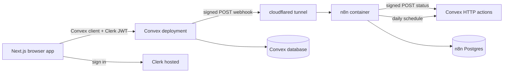
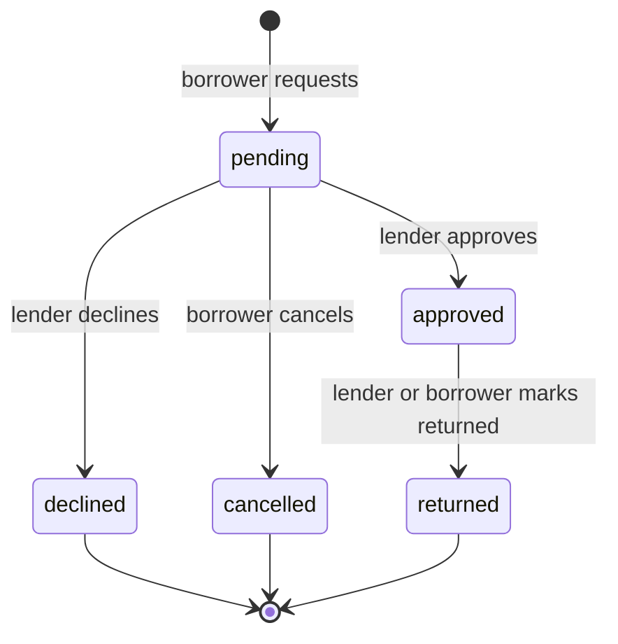
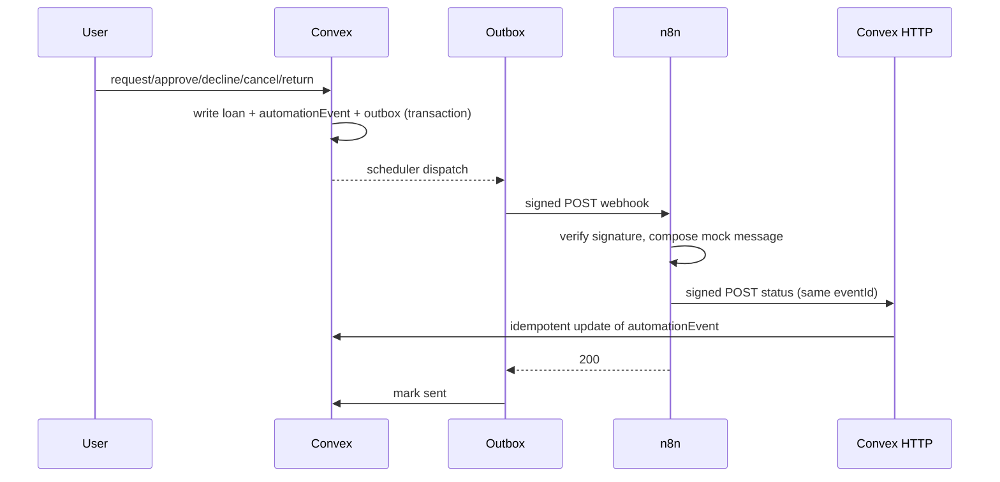
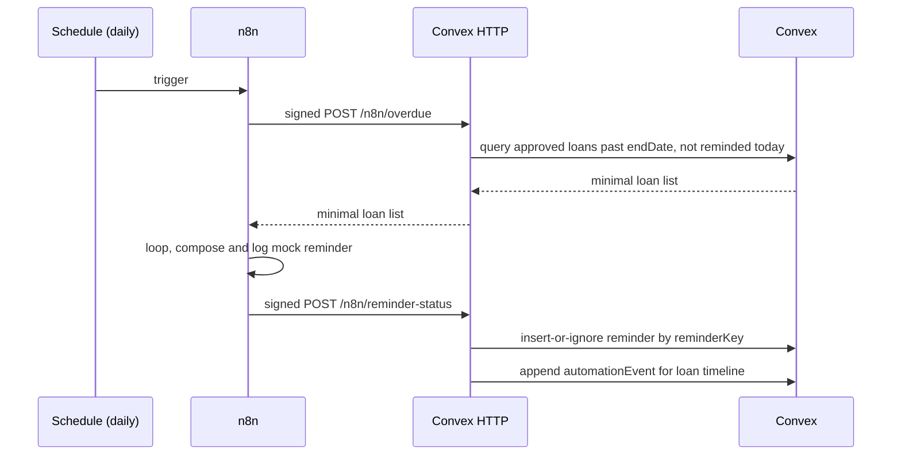

# LendLoop: Design Document

Date: 2026-11-02
Author: Nemesis (with Claude Code)
Status: Draft for approval

## 1. Context and intent

LendLoop is a take-home assignment for a company that awards contract work. The submission is judged on five axes:

1. Code structure and clarity
2. Security-minded thinking
3. UX and practicality
4. Integration design, reliability, and error handling (n8n)
5. Documentation and reasoning

The brief already fixes the stack and most of the feature surface. The real work is making judgment visible: an app that works, a security model that is enforced on the server, an n8n integration that survives failure, and documentation that explains why, not just how.

Success means a reviewer can open the repo and see a senior engineer's decisions in the code, the workflow JSON, and the README. The app does not need more features than the brief asks for.

### Anti-goals

- Feature creep beyond the brief.
- UI-only authorization or role checks that a client can bypass.
- Secrets or literal webhook URLs committed to the repo or exported workflow JSON.
- A "happy path only" n8n integration with no retries, no idempotency, and no visible failures.
- Clever abstraction for its own sake. Prefer the simplest code that is still industry-standard.

## 2. Fixed constraints from the brief

- Next.js App Router, TypeScript, Clerk, Convex, n8n.
- Public read-only tool list showing name and category only.
- Authenticated listing CRUD, borrow requests, approve/decline, mark returned.
- Filters by category, plus "My listings", "My requests", "Incoming requests" views.
- Two roles, `admin` and `user`, enforced in Convex functions.
- At least two n8n workflows: request notification webhook, daily overdue reminders.
- HMAC-signed payloads in both directions, secrets in environment variables and n8n credentials only.
- Idempotent write-backs, retries, and a visible error workflow.
- Exported n8n workflow JSON, docker-compose for local n8n, README, production note.
- Bonus: recent automation activity shown per loan.

## 3. Decisions made with Nemesis

| Decision | Choice | Why |
|---|---|---|
| Submission window | 24 hours | Scope must be cut to the brief plus the bonus, with tests on the security-critical paths only. |
| Notification channel | Logged mock, written back into Convex and shown in the app | No external accounts, no deliverability debugging, and the write-back doubles as the bonus automation timeline. |
| Local run | Cloud Clerk and Convex keys plus Docker Compose for app, n8n, Postgres, and a cloudflared tunnel | Clerk and Convex are hosted services. Self-hosted Convex is fragile and would consume the time budget. |
| Repository | Public GitHub repo named `lendloop` | Brief deliverable. No secrets in the repo. |
| UI implementation | `/ui-ux-pro-max` for the design pass plus 21st.dev registry/MCP for selected components, adapted to the project's tokens | Nemesis asked for this explicitly. Components are copied in and owned by the repo, not pulled in as a large runtime dependency. |
| Code complexity | Simplest code that is still industry-standard | Every non-obvious decision must be explainable in the README. |
| Reviewer experience | Seed data adopts the admin's email on first sign-in | Reviewers will run the repo themselves. A reviewer who signs in as themselves must see incoming requests, an overdue loan, and an automation timeline without creating a second account. |
| Delivery | Repository only, no live deployment | Confirmed with Nemesis. The 24 hours go into the app, the verified local stack, screenshots, and documentation instead of deployment risk. |
| Accounts | GitHub under `Noor-e-Bilal`, Convex CLI logged in, Clerk keys supplied locally, 21st.dev connected | Confirmed with Nemesis. The admin email is configured in Convex environment only and never committed. |
| Timezone | One board timezone from `BOARD_TIMEZONE`, with a one-day grace on request start dates | Avoids rejecting a date the user just picked from a date picker while keeping overdue logic deterministic. |
| Response signing | Only request payloads are HMAC-signed. Responses are TLS-protected and unsigned | The brief asks for signed payloads in both directions. Signing a response to a request the receiver initiated adds verification cost without a meaningful threat reduction. |
| Audit scope | Audit writes only, never reads | Convex queries cannot write. Firing a mutation on page load to record a read is a write-on-read smell that adds noise without improving security. |

## 4. Non-goals and explicit cuts

- No email, Slack, or Discord delivery. The mock channel is n8n writing a signed status back to Convex.
- No image uploads, avatars, or tool photos. Initials and category icons only.
- No chat, ratings, reviews, or payments.
- No self-hosted Convex.
- No Neighborhood or multi-tenant model. One board, many neighbors.
- No Playwright E2E suite. A focused Vitest plus `convex-test` suite covers RBAC, state transitions, signing, and idempotency.
- No dark mode. Tokens are structured so it can be added later.
- No live deployment. Delivery is the repo, verified locally, with screenshots and a reviewer walkthrough in the README.

## 5. Architecture

### 5.1 Runtime shape



Key point: Convex Cloud cannot reach `localhost`. The compose stack includes a `cloudflared` quick tunnel so Convex's outbound webhook has a public URL that forwards to the local n8n container. The tunnel URL changes on each start, so a small setup script reads it and writes `N8N_WEBHOOK_URL` into the Convex deployment environment.

### 5.2 Repository layout

```
lendloop/
  src/
    app/
      layout.tsx
      page.tsx                     public landing
      sign-in/[[...sign-in]]/page.tsx
      sign-up/[[...sign-up]]/page.tsx
      (app)/
        layout.tsx                 app shell + client auth guard
        browse/page.tsx
        listings/page.tsx
        requests/page.tsx
        incoming/page.tsx
        admin/page.tsx
      api/health/route.ts
    components/
      ui/                          copied 21st.dev/shadcn-style primitives
      tools/                       tool card, tool form, category filter
      loans/                       request dialog, loan row, activity timeline
      layout/                      nav, empty state, page header
    lib/
      convex.ts                    Convex + Clerk providers
      errors.ts                    ConvexError code mapping to toasts
      format.ts                    dates, labels, initials
      hooks/use-current-user.ts
  convex/
    schema.ts
    auth.config.ts
    http.ts                        signed n8n endpoints + health
    crons.ts                       outbox sweep + daily housekeeping
    users.ts
    tools.ts
    loans.ts
    automation.ts                  outbox dispatcher + reminder write-backs
    admin.ts
    seed.ts
    lib/
      auth.ts                      requireUser, requireAdmin, ownership
      permissions.ts               pure, unit-testable rules
      hmac.ts                      canonical JSON, sign, verify, timing-safe compare
      dates.ts                     YYYY-MM-DD helpers, overlap
      errors.ts                    ConvexError codes
      validators.ts                shared validators and limits
    tests/                         convex-test suites
  n8n/
    workflows/
      01-request-notifications.json
      02-overdue-reminders.json
      03-error-handler.json
  scripts/
    setup.mjs                      validate env, deploy functions, start stack, link tunnel
    seed.mjs
  docs/
    architecture.md
    security.md
    n8n-integration.md
    decisions.md
    production.md
    superpowers/specs/2026-11-02-lendloop-design.md
  docker-compose.yml
  Dockerfile
  .env.example
  README.md
```

### 5.3 Main request flows

- **Sign in:** Clerk session token includes a `convex` JWT template. Convex verifies the JWT via the issuer. `users.ensure` upserts a Convex user keyed by Clerk `subject` and applies admin bootstrapping from `ADMIN_EMAILS`.
- **Create listing:** mutation validates input, derives the owner from `ctx.auth`, writes the tool, writes an audit row.
- **Request to borrow:** mutation validates dates and overlap, snapshots the tool name and category onto the loan, writes the loan, writes an `automationEvent` and an `outbox` row, then schedules the dispatcher action.
- **Dispatcher:** action signs the minimized payload, POSTs to n8n, records delivery or reschedules with backoff. A cron sweeps stuck rows.
- **n8n request workflow:** verifies the signature, composes a message, logs it as the mock channel, writes status back to Convex with the same `eventId`. Only then does it return 200, so a failed write-back causes a Convex retry.
- **Status changes:** approve, decline, cancel, and return each write an event and enqueue a notification through the same outbox.
- **Overdue:** n8n runs daily, calls the signed overdue endpoint, sends a mock reminder per loan, and writes back a `reminderKey` that is unique per loan per day.

## 6. Data model

All tables use explicit validators. Dates for loans are stored as `YYYY-MM-DD` strings so range checks and lexicographic comparison are simple and stable. Timestamps are epoch milliseconds.

### users

```ts
{
  clerkId: string,        // Clerk subject, unique
  email: string,          // normalized lowercase
  name: string,
  imageUrl?: string,
  role: "user" | "admin",
  trustedLender: boolean,
  createdAt: number,
}
```

Indexes: `by_clerk_id`, `by_email`.

### tools

```ts
{
  ownerId: Id<"users">,
  name: string,           // 2..80 chars
  category: "power" | "garden" | "kitchen" | "camping" | "hand_tools" | "other",
  condition: "new" | "good" | "fair" | "well_loved",
  description: string,    // 10..600 chars
  status: "active" | "removed",
  removedAt?: number,
  createdAt: number,
  updatedAt: number,
}
```

Indexes: `by_owner`, `by_status_category` on `["status", "category"]`.

Soft removal preserves loan history and avoids broken references. A removed tool disappears from browse and cannot receive new requests. Pending requests on a removed tool are declined automatically. Approved loans remain valid until returned.

### loans

```ts
{
  toolId: Id<"tools">,
  lenderId: Id<"users">,      // denormalized at creation
  borrowerId: Id<"users">,
  toolName: string,           // snapshot, survives edits/removal
  toolCategory: string,       // snapshot
  startDate: string,          // YYYY-MM-DD, inclusive
  endDate: string,            // YYYY-MM-DD, inclusive
  status: "pending" | "approved" | "declined" | "cancelled" | "returned",
  message?: string,           // 0..400 chars
  respondedAt?: number,
  returnedAt?: number,
  returnedById?: Id<"users">,
  declineReason?: string,
  createdAt: number,
  updatedAt: number,
}
```

Indexes: `by_tool`, `by_lender_status`, `by_borrower_status`, `by_status_endDate` on `["status", "endDate"]`.

Overdue is derived: `status === "approved" && endDate < today`. No stored `overdue` status, so no cron needs to mutate loan rows.

### automationEvents

One row per notification or reminder event, used for the per-loan timeline and for outbox correlation.

```ts
{
  eventId: string,            // stable idempotency key
  loanId: Id<"loans">,
  type: "loan.requested" | "loan.approved" | "loan.declined" | "loan.cancelled" | "loan.returned" | "overdue.reminder",
  direction: "outbound" | "inbound",
  channel: string,            // "mock" for now
  status: "queued" | "delivered" | "failed" | "received",
  detail?: string,            // short human-readable summary, no PII beyond names
  createdAt: number,
  updatedAt: number,
}
```

Indexes: `by_event_id`, `by_loan_createdAt`.

### outbox

Reliable outbound delivery.

```ts
{
  eventId: string,
  payloadJson: string,        // minimized payload, signed over canonical form
  status: "pending" | "sending" | "sent" | "failed",
  attempts: number,
  nextAttemptAt: number,
  lastError?: string,
  createdAt: number,
  updatedAt: number,
}
```

Indexes: `by_event_id`, `by_status_nextAttemptAt`.

### reminders

Idempotent overdue reminder records written back by n8n.

```ts
{
  loanId: Id<"loans">,
  reminderKey: string,        // `${loanId}:${YYYY-MM-DD}`, unique
  reminderDate: string,
  channel: string,            // "mock"
  status: "sent" | "failed",
  sentAt: number,
  error?: string,
}
```

Index `by_reminder_key`.

### auditLog

Admin and destructive actions.

```ts
{
  actorId?: Id<"users">,
  action: string,             // "tool.remove", "user.setTrusted", "admin.viewLoans"
  targetType: string,
  targetId: string,
  detail?: string,
  createdAt: number,
}
```

Index `by_createdAt`.

### automationAlerts

Visible failures reported by the n8n error workflow.

```ts
{
  alertId: string,            // n8n execution id, unique
  workflowName: string,
  executionId: string,
  message: string,
  createdAt: number,
}
```

Index `by_alert_id`.

## 7. Domain rules and RBAC

### 7.1 Loan lifecycle



Rules:

- A borrower cannot request their own tool.
- A tool must be active.
- `startDate <= endDate`, `startDate >= today`, and the range cannot exceed 60 days.
- A new request cannot overlap an existing approved loan for the same tool.
- Approving a request re-checks overlap against all other approved loans and fails with `CONFLICT` if another approval won the race.
- Approve and decline are allowed only from `pending`.
- Cancel is allowed only by the borrower and only from `pending`.
- Mark returned is allowed by the lender or the borrower, only from `approved`.
- Removed tools cannot receive new requests; pending requests on removal are declined with a clear reason.
- A user may hold at most 5 pending requests per tool and 50 active listings. These guards are cheap abuse prevention.

**Board timezone.** `BOARD_TIMEZONE` (default `UTC`) defines "today" for start date validation, availability, overdue detection, and `daysOverdue`. It is computed once per request with `Intl.DateTimeFormat("en-CA", { timeZone })`, which returns `YYYY-MM-DD`. Request start dates accept a one-day grace so a user in a nearby timezone is never rejected for picking the date they see on their own calendar. All range comparisons remain string comparisons on `YYYY-MM-DD`. Per-user timezones are a documented production improvement.

### 7.2 Availability

Derived, never stored:

- `on_loan`: there is an approved loan where `startDate <= today <= endDate`.
- `reserved`: there is an approved loan with `startDate > today`.
- `available`: otherwise.

Public list shows active tools that are not `on_loan` today, with name and category only.

### 7.3 RBAC matrix

| Action | Anonymous | User | Admin |
|---|---|---|---|
| Read public tool list | yes, name and category only | yes | yes |
| Read full tool list with owner and availability | no | yes | yes |
| Create listing | no | yes, owner is self | yes |
| Edit or remove own listing | no | yes | yes |
| Edit or remove any listing | no | no | yes |
| Request to borrow | no | yes, as self | yes |
| Cancel own pending request | no | yes | yes |
| Approve or decline incoming request | no | lender only | lender only, plus admin read access |
| Mark returned | no | lender or borrower | lender or borrower |
| View "My listings", "My requests" | no | self only | self only |
| View all loans | no | no | yes |
| Mark a lender trusted | no | no | yes |
| View automation health and alerts | no | no | yes |

Admins are not automatically allowed to act on other users' loans. The brief gives admins removal and visibility powers, not impersonation. This is deliberate: it keeps the authorization model easy to reason about. Document it.

### 7.4 Enforcement pattern

Every protected query, mutation, and HTTP handler follows the same shape:

1. Derive the caller with `ctx.auth.getUserIdentity()`.
2. Load the Convex user row. Throw `UNAUTHENTICATED` if missing.
3. Load the target record. Throw `NOT_FOUND` for missing or removed records where appropriate.
4. Call a pure permission function from `convex/lib/permissions.ts` with the caller, the record, and the action.
5. Throw `ConvexError({ code: "FORBIDDEN" })` on denial.
6. Validate state transition separately from authorization.

The pure functions are unit-tested without Convex, and the mutations are tested with `convex-test` under different identities. User ids, roles, and ownership never come from client arguments.

Admins are identified by role in the Convex `users` table, seeded from the `ADMIN_EMAILS` Convex environment variable on `users.ensure`. Promotion is additive only, so a typo in the env var cannot silently demote the only admin. A CLI-runnable internal mutation exists for manual reconciliation.

## 8. Public data minimization

`tools.publicList` returns an explicit projection:

```ts
{ _id, name, category }
```

It does not return `ownerId`, owner name, condition, description, or any loan data. The UI cannot leak what the query never sends. The README explains that this is both a privacy decision and a direct response to the brief.

Authenticated queries return owner display name and trusted status, because borrowing from a neighbor requires knowing who they are.

## 9. n8n integration

### 9.1 Event flow



Overdue flow:



### 9.2 Signing scheme

Both directions use HMAC-SHA256 with different secrets:

- `N8N_OUTBOUND_SECRET`: Convex signs, n8n verifies.
- `N8N_INBOUND_SECRET`: n8n signs, Convex verifies.

Canonical string:

```
v1
<unix timestamp seconds>
<nonce or event id>
<canonical JSON of payload>
```

`canonical JSON` means recursively sorted object keys, arrays kept in order, `JSON.stringify` with no whitespace, and standard JSON number serialization. Signing the canonical form instead of raw bytes avoids the classic problem where two JSON serializers produce different whitespace and break verification. The same canonicalizer is implemented in TypeScript and in the n8n Code node, with shared test vectors in `docs/n8n-integration.md`.

Request headers:

- `x-lendloop-timestamp`: Unix seconds.
- `x-lendloop-nonce`: random or event id, used for log correlation.
- `x-lendloop-signature`: `v1=<hex>`.

Verification rules on both sides:

- Reject a timestamp more than 300 seconds from now.
- Recompute the HMAC and compare with a constant-time comparison.
- Reject a missing or malformed header before doing any work.
- Never log the secret or the full signature.

**Responses are not signed.** n8n verifies every request payload it receives, and Convex verifies every write-back. The overdue response and the webhook 200 acknowledgement are not HMAC-signed: they travel over TLS inside a request the receiver initiated, and the only consumer is the workflow that made the call. Signing them would add a verification node and test vectors without changing the threat model. This is written up in `docs/n8n-integration.md` so the choice reads as deliberate rather than forgotten.

Write endpoints rely on idempotency keys on top of the timestamp window. A replayed write with a known key is a no-op that returns 200, which is safer for retries than a hard rejection.

### 9.3 Outbox and retries

The loan mutation writes the domain change and the outbox row in one Convex transaction, so there is no window where a loan exists but its notification was forgotten. The transaction schedules `internal.automation.dispatchOutbox`.

Dispatcher behavior:

- Load the row. If it is not `pending`, return.
- Mark `sending`, increment `attempts`, and compute the signature.
- POST to `N8N_WEBHOOK_URL` with a 10 second timeout.
- On 2xx, mark `sent` and set the automation event to `delivered`.
- On failure, store `lastError`. If attempts remain, set `pending` with a backoff delay (30s, 2m, 10m, 1h, 6h) and reschedule. After six attempts, mark `failed`, mark the event `failed`, and write an `automationAlerts` row.
- A five-minute cron sweeps `pending` rows whose `nextAttemptAt` has passed, so a lost scheduler callback cannot strand a row.

The admin automation view shows queued, failed, and delivered counts, plus the last errors. Failures are visible in the product, not only in logs.

### 9.4 Endpoint contract

`POST /n8n/overdue` (n8n to Convex, signed)

Request:

```json
{ "limit": 100 }
```

Response:

```json
{
  "generatedAt": 1762080000000,
  "loans": [
    {
      "loanId": "jd7...",
      "reminderKey": "jd7...:2026-11-02",
      "toolName": "Cordless drill",
      "dueDate": "2026-10-30",
      "daysOverdue": 3,
      "borrower": { "name": "Sam", "email": "sam@example.com" },
      "lenderName": "Alex"
    }
  ]
}
```

The endpoint excludes loans already reminded on the board's current date and caps results at 200. Pagination is a documented production improvement. The response is not HMAC-signed; see the note in 9.2.

`POST /n8n/reminder-status` (n8n to Convex, signed)

```json
{
  "loanId": "jd7...",
  "reminderKey": "jd7...:2026-11-02",
  "reminderDate": "2026-11-02",
  "channel": "mock",
  "status": "sent",
  "sentAt": 1762080000000,
  "error": null
}
```

Behavior: insert if `reminderKey` is new, otherwise update status and error. Always append one `automationEvent` per `reminderKey`, using the key as the event id so retries cannot duplicate the timeline entry.

`POST /n8n/automation-event` (n8n to Convex, signed)

Used by the request workflow to write delivery status back.

```json
{
  "eventId": "uuid",
  "loanId": "jd7...",
  "status": "delivered",
  "channel": "mock",
  "detail": "Request notification sent (mock)"
}
```

Idempotent on `eventId`. Unknown event ids are rejected with 404 so a bad workflow cannot invent history.

`POST /n8n/automation-alert` (n8n to Convex, signed)

Used by the error workflow. Idempotent on `alertId` (the n8n execution id).

`GET /health` (unsigned, minimal)

Returns `{ ok: true, now }`. Used by compose healthchecks and uptime monitors.

All HTTP handlers return JSON with `{ error: { code, message } }` on failure and never echo secrets or stack traces.

### 9.5 Workflow 1: request notifications

`n8n/workflows/01-request-notifications.json`

Nodes:

1. **Webhook** `POST /webhook/lendloop-requests`, raw body handling is not required because signing is canonical, respond only after processing.
2. **Code: verify signature** reads `$env.N8N_OUTBOUND_SECRET`, rebuilds the canonical string from the parsed body, compares with `crypto.timingSafeEqual`, and throws on mismatch or stale timestamp.
3. **Switch** on `eventType` to choose the notification copy for requested, approved, declined, cancelled, and returned.
4. **Code: compose mock notification** builds a short message for the intended recipient and logs it with the event id. This is the mock channel. No third-party service is contacted.
5. **HTTP Request: write-back** POSTs to `${CONVEX_SITE_URL}/n8n/automation-event`, signed with `N8N_INBOUND_SECRET`, body includes the same `eventId`.
6. **Respond to Webhook** with 200 only if the write-back succeeded.

Node retry settings: `retryOnFail: true`, `maxTries: 3`, `waitBetweenTries: 5000` on the write-back. Workflow error workflow is set to workflow 3.

Returning 200 only after the write-back means a write-back failure causes Convex to retry the whole event. The notification is a mock log, so duplicate logs on retry are acceptable and the timeline stays idempotent.

### 9.6 Workflow 2: overdue reminders

`n8n/workflows/02-overdue-reminders.json`

Nodes:

1. **Schedule Trigger**: daily at 09:00 in `GENERIC_TIMEZONE`.
2. **HTTP Request: fetch overdue** POST to `${CONVEX_SITE_URL}/n8n/overdue`, signed with `N8N_INBOUND_SECRET`.
3. **IF: any loans** to exit cleanly when there is nothing to do.
4. **Split In Batches**: batch size 10.
5. **Code: compose mock reminder** builds the message from borrower, tool, due date, and days overdue.
6. **HTTP Request: write status** POST to `${CONVEX_SITE_URL}/n8n/reminder-status`, signed, with the `reminderKey` from the fetch response.
7. **Loop** until batches are exhausted.

Retry settings on both HTTP nodes. Error workflow set to workflow 3. The reminder key is the idempotency boundary: a retried write updates the same row and never creates a second reminder record.

### 9.7 Workflow 3: error handler

`n8n/workflows/03-error-handler.json`

- **Error Trigger** fires for any workflow that names it as its error workflow.
- **Code** builds `{ alertId: execution.id, workflowName, executionId, message }`.
- **HTTP Request** POSTs to `${CONVEX_SITE_URL}/n8n/automation-alert`, signed, with retries.
- The admin automation view lists these alerts so a failed run is visible inside LendLoop, not only in the n8n execution log.

### 9.8 n8n configuration and import

Compose services:

- `n8n` with Postgres, `N8N_ENCRYPTION_KEY`, `GENERIC_TIMEZONE`, `N8N_BLOCK_ENV_ACCESS_IN_NODE=false` so Code nodes can read `$env`.
- `n8n-import` one-shot service that runs `n8n import:workflow --separate --input=/workflows` and activates imported workflows.
- Secrets are supplied by environment only. Exported JSON contains `$env.*` references, never literal secrets.

## 10. Frontend design

### 10.1 Design direction

Minimal, warm, community-trustworthy. Not a generic SaaS dashboard.

Tokens:

- Canvas `#FAF8F4`, surface `#FFFFFF`, ink `#1F2621`.
- Primary deep green `#2F6B4F`, secondary amber `#C98B3C`.
- Muted text `#6B7268`, border `#E4DED3`, danger `#B4453C`.
- Radius 14px for cards, 10px for controls.
- Type: one sans for UI, one display face for the hero. Use `next/font`.
- Generous whitespace, thin borders, almost no shadows.

Implementation path:

1. Invoke `/ui-ux-pro-max` at the start of the UI phase for layout, hierarchy, and polish guidance.
2. Use the 21st.dev registry/MCP to fetch a small set of components (dialog, dropdown, tabs, toast, select). Adapt them to the tokens and copy them into `src/components/ui`.
3. Do not add a heavyweight component library. Every copied component is readable and owned by the repo.
4. Verify keyboard focus, contrast, and mobile layout before calling the UI done.

### 10.2 Routes and experiences

**`/` public**

- Nav with LendLoop wordmark and a "Sign in to lend or borrow" button.
- Hero: tagline "Borrow what you need. Lend what you don't."
- Category filter chips.
- Grid of available tools showing name and category only.
- Empty state when no tools are available.
- A quiet note: "Owner details stay private until you sign in."

**`/browse` authenticated**

- App shell with nav: Browse, My listings, My requests, Incoming, Admin (admins only).
- Cards show name, category, condition, availability pill, owner name, trusted badge.
- Category filter.
- Request action on tools that are available or reserved and not owned by the caller.
- Request dialog: start date, end date, optional message, inline validation.

**`/listings`**

- Create listing form or dialog.
- Cards with edit, remove, and a compact summary of pending and active loans.
- Remove requires confirmation and explains that pending requests will be declined.

**`/requests`**

- Requests the caller made, with status, tool, dates, lender, and cancel on pending.
- Activity timeline, including automation events.

**`/incoming`**

- Requests on the caller's tools, pending first.
- Approve or decline with optional reason.
- Approved loans have a "Mark returned" action.

**`/admin`**

- Tabs: Tools, Loans, Users, Automation.
- Tools: remove any listing.
- Loans: all loans with status and dates.
- Users: list with role and trusted toggle.
- Automation: outbox failures, alerts, recent events.
- Every admin action writes an `auditLog` row.

**Loan detail**

- Drawer or dialog reachable from request rows.
- Timeline: requested, approved or declined, returned, reminders sent, with relative times like "Reminder sent 2 days ago". This is the bonus requirement.

### 10.3 UX standards

- Loading skeletons, not spinners on blank screens.
- Empty states with one clear action.
- Toasts for success and failure, with the server's error code mapped to plain language.
- Destructive actions always confirm.
- Dates show as readable local dates, stored as `YYYY-MM-DD`.
- Mobile: single column, bottom-safe action buttons, no horizontal scroll.
- Accessibility: semantic landmarks, labeled inputs, visible focus rings, `aria-live` for toasts, contrast checked.

### 10.4 Client architecture

- `ConvexProviderWithClerk` inside `ClerkProvider` at the root.
- `useConvexAuth` drives loading, signed-out, and signed-in states.
- The `(app)` layout guards for UX only. Convex functions are the real boundary. This is documented explicitly so the reviewer sees the reasoning.
- Queries are scoped by the server, not by client-supplied ids.
- `users.ensure` runs once after authentication via a small hook.

## 11. Local setup and Docker

### 11.1 Environment variables

| Variable | Where it lives | Purpose |
|---|---|---|
| `NEXT_PUBLIC_CONVEX_URL` | root `.env`, build arg | Convex deployment URL |
| `CONVEX_DEPLOYMENT` | root `.env` | Convex CLI target |
| `NEXT_PUBLIC_CLERK_PUBLISHABLE_KEY` | root `.env`, build arg | Clerk client |
| `CLERK_JWT_ISSUER_DOMAIN` | Convex env | JWT verification in `auth.config.ts` |
| `ADMIN_EMAILS` | Convex env | comma-separated admin bootstrap list |
| `APP_BASE_URL` | Convex env | links in notification payloads |
| `N8N_WEBHOOK_URL` | Convex env | public tunnel URL to n8n |
| `N8N_OUTBOUND_SECRET` | Convex env and n8n env | sign Convex to n8n |
| `N8N_INBOUND_SECRET` | Convex env and n8n env | sign n8n to Convex |
| `CONVEX_SITE_URL` | n8n env | n8n write-back base URL |
| `N8N_ENCRYPTION_KEY` | compose env | n8n credential encryption |
| `POSTGRES_PASSWORD` | compose env | n8n database |
| `GENERIC_TIMEZONE` | compose env | daily schedule |
| `BOARD_TIMEZONE` | Convex env | defines "today" for validation and overdue |
| `ALLOW_SEED` | Convex env | gates the seed function |

`.env.example` contains every key with safe placeholder values. `.gitignore` excludes `.env`, `.env.local`, `.convex`, `n8n_data`, and `node_modules`.

### 11.2 Compose stack

- `app`: production Next.js standalone build on port 3000. Public env vars passed as build args because Next inlines `NEXT_PUBLIC_*` at build time.
- `n8n`: port 5678, Postgres database, workflows mounted read-only.
- `postgres`: named volume.
- `cloudflared`: quick tunnel to `http://n8n:5678`, public URL parsed from logs.
- `n8n-import`: one-shot import and activation.
- Healthchecks on app and n8n.

### 11.3 Setup script

`npm run setup` performs:

1. Validate required keys in `.env`.
2. Push the schema and functions with `npx convex dev --once` or `npx convex deploy`.
3. Set Convex environment variables from `.env`.
4. Start the compose stack.
5. Wait for the cloudflared URL and set `N8N_WEBHOOK_URL` on the Convex deployment.
6. Print the app URL, the n8n URL, and the seed command.

A separate `npm run dev` path runs Convex and Next in watch mode for development. Both paths are documented. The README is honest that Clerk and Convex require free accounts; the phrase "one command" refers to the Docker stack after those keys exist.

### 11.4 Reviewer quick start

Because the company runs the repo themselves, the setup path is a deliverable, not an afterthought. The README opens with:

1. Prerequisites: Node 20+, Docker Desktop, free Clerk and Convex accounts.
2. A five-step account setup: create a Clerk app, create the `convex` JWT template, run `npx convex login`, set the six required keys in `.env`, and set `ADMIN_EMAILS`.
3. `npm run setup`, then `npm run seed`, then open `http://localhost:3000`.
4. Expected output at each step, including the tunnel URL line and the seeded credentials note.
5. A troubleshooting table for the five failures most likely on Windows and macOS: Convex not linked, Clerk JWT template missing or misnamed, tunnel not ready, n8n import not finished, and port already in use.

The README also contains screenshots of every view and a two-minute reviewer walkthrough, so a reviewer can evaluate the UX without running anything. Screenshots are taken from the seeded admin account, which shows the populated two-sided flow.

### 11.5 Seed data

`npm run seed` creates:

- A placeholder user for each address in `ADMIN_EMAILS`, with `clerkId: "seed:<email>"`.
- Four fictional neighbors.
- Eight tools across power, garden, kitchen, camping, and hand tools.
- Three loans tied to the first admin address: a pending incoming request on an admin-owned tool, an approved overdue loan on an admin-owned tool, and a pending request from the admin to a fictional neighbor.

When the real admin signs in for the first time, `users.ensure` matches the placeholder by email from the verified Clerk JWT, replaces the placeholder `clerkId` with the real Clerk subject, and keeps all seeded tools and loans. The admin therefore lands on populated "Incoming", "My requests", and "Admin" views, and the overdue timeline has content. A second real account can test the borrower side of the two-sided flow. Adoption is safe because Clerk verifies email ownership before the JWT is issued.

Seed is idempotent via deterministic keys and refuses to run unless `ALLOW_SEED=true`. It targets development deployments only. Fixture dates are computed relative to the board's today, never hardcoded, so the seed does not go stale.

### 11.6 Human steps that cannot be automated

These are sequenced at the start of the build so they do not strand the integration phase later:

- `npx convex login` and the first deployment selection are browser-based.
- Creating the Clerk `convex` JWT template is a dashboard action.
- `ADMIN_EMAILS` needs the real address that will own the admin experience.
- The 21st.dev registry needs a login or API key before components can be fetched.
- The GitHub repository must be created under the intended account. The current `gh` session belongs to `Noor-e-Bilal`, which must be confirmed before any push.

## 12. Security design

### 12.1 Threat model

| Threat | Mitigation |
|---|---|
| Client calls a mutation with someone else's id | Identity is derived from the verified Clerk JWT, never from arguments. Ownership checked in the mutation. |
| Client hides an admin-only button and still calls the API | Role read from the Convex user row and checked in every admin function. |
| Public page leaks owner details | Public query returns an explicit projection of name and category only. |
| Forged webhook call | HMAC-SHA256 over a canonical payload, separate secrets per direction, constant-time compare, 300 second timestamp window. |
| Replayed webhook | Timestamp window plus idempotency keys on every write. Replays are no-ops returning 200. |
| Secret leak through repo or workflow JSON | Secrets only in env and n8n credentials. `.gitignore` covers `.env`. Exported JSON uses `$env` references. |
| Duplicate reminders after a retry | `reminderKey` is unique per loan per day. Write-back is insert-or-update. |
| Double booking a tool | Overlap validation at request time and again at approval time. |
| Notification silently lost | Transactional outbox, scheduler retries with backoff, cron sweep, admin-visible failure state, n8n error workflow. |
| Abuse and spam | Length limits, listing and pending request caps, server-side validation. |
| PII spread through automation | Payloads carry only one recipient, one actor, tool name, dates, and status. No addresses, images, descriptions, or Clerk ids. |
| Admin lockout | Admin promotion is additive from `ADMIN_EMAILS`; demotion is not automatic. |

### 12.2 Input validation

All inputs use Convex validators plus semantic checks in `convex/lib/validators.ts`:

- Name 2 to 80 characters, trimmed.
- Description 10 to 600 characters, trimmed.
- Message 0 to 400 characters.
- Category and condition from fixed unions.
- Date format, ordering, range, and not in the past.
- Malformed or oversized input returns `VALIDATION` with a safe message.

### 12.3 Secrets and operational safety

- Two distinct HMAC secrets, never reused for another purpose.
- No secret is logged. Errors log event ids and status codes only.
- n8n's encryption key is generated for local use and never committed.
- The README documents rotation: set a new secret in both places, allow the old one for one deploy if needed.
- Admin bootstrap uses email matching from the verified JWT, not a client-supplied flag.

### 12.4 Audit trail

Admin removal and trusted lender changes write `auditLog` rows with actor, action, and target. Reads are not audited: Convex queries are read-only, and a mutation fired on page load to record a view is a write-on-read pattern that adds noise without improving security. The admin loans view is authorized, not audited. The audit log is append-only in application code.

The audit model is described in `docs/security.md` with the language of a compliance-adjacent system: who did what, to which record, when, and through which interface. Loan state changes are reconstructable from `loans`, `automationEvents`, and `auditLog`. Payloads intentionally exclude free-text descriptions and addresses, so the audit trail itself stays low-PII.

### 12.5 Observability and logging

- Convex functions log structured events with `{ event, eventId, loanId, outcome }`. No secrets, no full payloads, no email addresses in log messages.
- Every outbound attempt logs the outbox id, attempt number, HTTP status, and a short error category.
- HTTP actions log the signature result and the idempotency outcome, which makes forged or replayed requests visible without logging the signature itself.
- The admin automation view exposes queue depth, failure count, alerts, and the last error per row.
- `GET /health` gives the compose healthcheck and any uptime monitor a cheap liveness signal.
- The production note maps these signals to CloudWatch, Datadog, and Sentry, since the job description names them.

## 13. Testing

`convex-test` plus Vitest, no deployment required.

Must-have suites:

1. **RBAC**: a user cannot edit or remove another user's tool, cannot approve another user's incoming request, cannot list all loans; an admin can remove any tool and toggle trusted status.
2. **Lifecycle**: pending to approved, declined, cancelled, returned; invalid transitions throw `INVALID_STATE`; approve re-checks overlap.
3. **Validation**: own-tool request, past dates, reversed range, over 60 days, overlapping approved loan, removed tool, and the one-day board timezone grace.
4. **Idempotency**: record the same reminder twice and get one row; replay an automation event and get one timeline entry.
5. **Signing**: canonical JSON vector, valid signature passes, tampered body fails, stale timestamp fails, wrong secret fails.
6. **Overdue query**: only approved loans past `endDate`, excludes returned and pending, excludes loans reminded today.
7. **Outbox**: success marks sent, failure schedules a retry, exhausted attempts mark failed and alert.
8. **Seed adoption**: `users.ensure` matches a seeded placeholder by email, replaces its Clerk id, and preserves role, tools, and loans.

CI runs install, lint, typecheck, and test on push. A production build runs with placeholder public env values.

## 14. Documentation deliverables

**README.md**

- What LendLoop is, with screenshots of every view.
- A two-minute reviewer walkthrough using the seeded admin account.
- Quick start with prerequisites, free account setup, and the Docker path.
- Troubleshooting table for the five most likely setup failures.
- Architecture diagram and a walkthrough of the request and overdue flows.
- Data model and lifecycle.
- RBAC matrix.
- Automation and signing summary.
- Security decisions, auditability, privacy, and data minimization.
- Observability and failure visibility.
- Testing.
- Project structure.
- Deliverables mapped to the brief's five evaluation axes.
- A short mapping to the role's themes: secure auth and RBAC, privacy and auditability, observability, API integration, automation, and documentation.
- "What I would change for production", including an AWS deployment shape.

**docs/**

- `architecture.md`: deeper component and data-flow notes.
- `security.md`: threat model, authorization model, secret handling, data minimization.
- `n8n-integration.md`: endpoint contracts, canonical signing with test vectors, idempotency, retry and error behavior, how to import workflows.
- `decisions.md`: short ADR-style entries for the choices a reviewer might question (logged mock, soft delete, snapshot fields, derived overdue, outbox, cloud Convex plus tunnel).
- `production.md`: the production note.

## 15. What would change for production

- Run Convex in a production deployment with backups, and Clerk in a production instance with a custom domain.
- Host n8n in queue mode with Postgres and Redis, pinned versions, and credentials for real email or chat delivery.
- Replace the quick tunnel with a stable ingress, mTLS or network allowlisting, and rotate secrets on a schedule.
- Replace or extend the outbox with a durable queue and dead-letter queue, with SLOs and alerting.
- Use a claim-then-send reminder flow so a crash between send and write-back cannot produce duplicate reminders.
- Add rate limiting and bot protection at the edge.
- Add observability: structured logs, traces, metrics, and alerts on outbox depth and n8n failures.
- Add end-to-end tests and contract tests between Convex and n8n.
- Add data retention and deletion policy for loans and automation payloads.
- Add moderation and abuse reporting for public listings.
- Add real timezone handling per user instead of one board timezone.
- Add image storage with signed URLs and content moderation if photos are introduced.
- Map the current services to AWS for a production deployment: ECS or Fargate for the Next.js app, RDS or DynamoDB for relational data if Convex is not retained, API Gateway in front of HTTP actions, Cognito or Clerk for identity, S3 and CloudFront for assets, and CloudWatch for logs and metrics. Convex can stay as the data platform, which is the bonus the brief calls out.
- Add Datadog APM and Sentry error reporting, with release tagging and alert routing.
- Add a durable queue with a dead-letter queue and SLOs on automation latency.

## 16. Build order for the 24 hours

| Phase | Work | Estimate |
|---|---|---|
| 0 | Scaffold Next.js, Convex, Clerk, Tailwind, base tokens, env files | 2h |
| 1 | Schema, auth sync, RBAC helpers, tools and loans mutations, tests | 5h |
| 2 | Public page, app shell, browse, filters, request dialog | 4h |
| 3 | Listings, requests, incoming, admin, timelines | 4h |
| 4 | Outbox, signed HTTP endpoints, three n8n workflows, docker-compose | 4h |
| 5 | Seed, setup script, tunnel link, manual end-to-end verification | 2h |
| 6 | README, docs, screenshots, reviewer walkthrough, troubleshooting table, CI, final review | 3h |

Buffer: 1 hour. If time runs short, cut admin audit screen polish, then the optional deployment. Do not cut tests, signing, idempotency, or documentation.

## 17. Builder freedom

These are left to the builder as implementation calls:

- Exact Tailwind token names and component file breakdown.
- Whether the request dialog is a dialog or a dedicated route.
- Whether the activity timeline is a drawer or an inline expandable row.
- Exact copy and empty state illustrations.
- Whether the setup script is Node or shell, as long as one documented command works on Windows and macOS.
- Exact retry backoff constants within the stated ranges.
- Whether `users.ensure` is a mutation called by a hook or an action wrapper.

## 18. Acceptance checklist mapped to the brief

**Public page**

- [ ] LendLoop name and tagline.
- [ ] Available tools with name and category only.
- [ ] Sign in button wired to Clerk.
- [ ] No owner details in the payload or the UI.

**Authenticated experience**

- [ ] Create, edit, delete own listings.
- [ ] Request a tool for a date range.
- [ ] Approve or decline incoming requests.
- [ ] Mark a loan returned.
- [ ] All tools with availability, filterable by category.
- [ ] My listings, My requests, Incoming requests views.
- [ ] Clean, minimal, responsive layout.

**Roles and rules**

- [ ] Admin can remove any listing, view all loans, mark trusted lender.
- [ ] User can act only on own listings and own loans.
- [ ] RBAC enforced in Convex, with tests.

**Automation**

- [ ] Request webhook fires on creation and status change.
- [ ] Daily overdue workflow fetches, reminds, and writes back.
- [ ] HMAC signing in both directions with separate secrets.
- [ ] Secrets only in env and credentials.
- [ ] Idempotent write-backs.
- [ ] Retries and a visible error workflow.
- [ ] Bonus: recent automation activity on each loan.

**Deliverables**

- [ ] Public repo with app source.
- [ ] Exported workflow JSON in the repo.
- [ ] README with setup, env vars, architecture, security, data minimization, screenshots, and a reviewer walkthrough.
- [ ] Production note.
- [ ] Repo runs locally from documented steps with no live deployment required.
