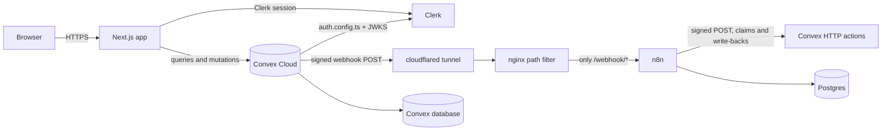
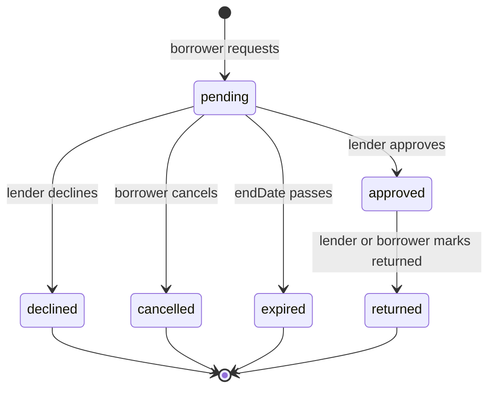

# LendLoop: Design Document

Date: 2026-11-02
Author: Nemesis (with Claude Code)
Status: Draft for approval (hardened after three adversarial reviews)

## 1. Context and intent

LendLoop is a take-home assignment for a company that awards contract work. The submission is judged on five axes:

1. Code structure and clarity
2. Security-minded thinking
3. UX and practicality
4. Integration design, reliability, and error handling (n8n)
5. Documentation and reasoning

The brief fixes the stack and most of the feature surface. The real work is making judgment visible: an app that works, a security model enforced on the server, an n8n integration that survives failure, and documentation that explains why, not just how.

Success means a reviewer can open the repo, run it with their own free Clerk and Convex accounts, and see a senior engineer's decisions in the code, the workflow JSON, and the README. The app does not need more features than the brief asks for.

### Anti-goals

- Feature creep beyond the brief.
- UI-only authorization or role checks a client can bypass.
- Secrets or literal webhook URLs committed to the repo or exported workflow JSON.
- A "happy path only" n8n integration with no retries, no idempotency, and no visible failures.
- Clever abstraction for its own sake. Prefer the simplest code that is still industry-standard.
- Silent failure. Every background failure must surface in the admin automation view.

## 2. Fixed constraints from the brief

- Next.js App Router, TypeScript, Clerk, Convex, n8n.
- Public read-only tool list showing name and category only.
- Authenticated listing CRUD, borrow requests, approve/decline, mark returned.
- Filters by category, plus "My listings", "My requests", "Incoming requests" views.
- Two roles, `admin` and `user`, enforced in Convex functions.
- At least two n8n workflows: request notification webhook and daily overdue reminders.
- HMAC-signed webhook payloads in both directions (Convex to n8n and n8n to Convex), with signatures verified on the receiving side. Secrets live in environment variables and n8n credentials only.
- Idempotent write-backs, retries, and a visible error workflow.
- Exported n8n workflow JSON, docker-compose for local n8n, README, and a short production note.
- Bonus: recent automation activity shown per loan.

Response signing is addressed in 9.2. The overdue response carries data, so it is signed. The request acknowledgement carries no data, so it is not. This satisfies "webhook payloads in both directions" without signing an empty ack.

Two things go beyond the literal brief and are deliberate. Photos are added because a tool-lending product without them is not credible to a reviewer, and the brief's public projection (name and category) still holds, so photos stay behind authentication. Playwright is added because the brief grades the working app; server tests alone do not prove the signed-in path works. Both are scoped to one photo and one happy path to protect the schedule.

## 3. Decisions made with Nemesis

| Decision | Choice | Why |
|---|---|---|
| Submission window | 24 hours | Scope is cut to the brief plus the bonus, with tests on the security-critical paths. |
| Notification channel | Logged mock, written back into Convex and shown in the app | No external accounts, no deliverability debugging, and the write-back doubles as the bonus automation timeline. |
| Local run | Cloud Clerk and Convex keys plus Docker Compose for app, n8n, Postgres, a path-filtering proxy, and a cloudflared tunnel | Clerk and Convex are hosted services. Self-hosted Convex is fragile and would consume the time budget. |
| Delivery | Public GitHub repo under `Noor-e-Bilal`, no live deployment | Confirmed with Nemesis. The 24 hours go into the app, a verified local stack, screenshots, and documentation instead of deployment risk. |
| Repository | Public GitHub repo named `lendloop` | Brief deliverable. No secrets in the repo. |
| UI implementation | `/ui-ux-pro-max` for the design pass plus 21st.dev registry for selected components, copied into the repo and adapted to project tokens | Nemesis asked for this. Components are committed with their dependencies; the reviewer never needs 21st.dev access. |
| Code complexity | Simplest code that is still industry-standard | Every non-obvious decision must be explainable in the README. |
| Reviewer experience | Seed data adopts the reviewer's own admin email on first sign-in, and `npm run seed` is re-runnable after `ADMIN_EMAILS` changes | A reviewer who signs in as themselves must see incoming requests, an overdue loan, and an automation timeline without creating a second account. |
| Identity claims | Clerk `convex` JWT template explicitly includes `email`, `email_verified`, and `name`; verified email is required | Clerk's default token omits these claims. Admin promotion and seed adoption are privilege operations and must require proof of email ownership. |
| Photos | One photo per tool, stored in Convex file storage, shown on authenticated browse, detail, and listings. Never on the public page | Tool lending without a photo is not credible, and Convex storage means no extra service. The brief limits the public projection to name and category, so the public page stays text-only. |
| End-to-end test | Playwright, Chromium only, one happy path through request approval plus one authorization negative | Unit tests prove the server rules; an E2E proves the reviewer's path actually works with Clerk and Convex wired together. Clerk testing tokens avoid a test-only auth backdoor. |
| Timezone | A Phase 0 spike tests whether `Intl` with a timezone works in the Convex runtime. If it does, store each user's IANA zone and use it for date validation and overdue display. If not, one board date from `BOARD_UTC_OFFSET_MINUTES` plus a one-day grace | Per-user timezones are the correct design, but they depend on runtime tz data that was not verified. A ten-minute spike turns an assumption into a measured decision instead of a guess. |
| Response signing | Overdue response is HMAC-signed and verified by n8n. The empty request acknowledgement is not signed | Closes the "both directions" ambiguity and protects the PII-bearing response. The ack carries no data. |
| Audit scope | Audit writes only, never reads. Admin promotion and demotion are audited | Convex queries cannot write. A mutation fired on page load to record a view is a write-on-read smell. |
| n8n version | Pin the exact image version after the first successful smoke test; never use `latest` | Import and activation commands changed between major versions. The README records the tested version. |
| Tunnel exposure | cloudflared tunnels to a path-filtering proxy, not to n8n directly; the n8n editor binds to localhost | A quick tunnel to n8n would expose the editor and REST API, and with env access enabled, every secret. |

## 4. Non-goals

- chat or messaging
- payment or deposits
- email, SMS, or push delivery. The channel is a logged mock.
- photo moderation, multiple photos per tool, and photo editing
- live deployment
- self-hosted Convex
- AI features. Nothing in this brief needs a model call.

### Backlog, explicitly deferred and not attempted

These are recorded so the reviewer sees they were considered, not missed. Each is deliberately out of the 24-hour scope.

- **Dark mode.** The design tokens are already CSS variables, so a `[data-theme="dark"]` block is the implementation. Deferred because it needs its own contrast pass across six routes and the accent palette does not carry over without retuning.
- **Per-user timezones and DST-correct board dates.** See 7.1: a Phase 0 spike decides whether `Intl` is available in the Convex runtime. If it is, per-user timezone is implemented; if not, one board offset plus a one-day grace is the shipped behavior.
- **Real email or SMS delivery.** The mock channel plus write-back is the tested path.
- **Chat between borrower and lender.** The request `message` field carries the conversation.
- **Photo moderation, multiple photos, and image editing.**
- **Browser matrix testing beyond Chromium.**

## 5. Architecture

### 5.1 System diagram



Key point: Convex Cloud cannot reach `localhost`. The compose stack includes a `cloudflared` quick tunnel whose public URL forwards only `/webhook/*` to n8n through an nginx proxy. The n8n editor is bound to `127.0.0.1:5678` and is never exposed through the tunnel. The tunnel URL changes on each start, so the setup script reads it and writes the full webhook URL into the Convex deployment environment.

### 5.2 Repository layout

```text
lendloop/
  src/
    app/
      layout.tsx
      page.tsx                     public landing
      sign-in/[[...sign-in]]/page.tsx
      sign-up/[[...sign-up]]/page.tsx
      (app)/
        layout.tsx                 app shell + client auth guard
        browse/page.tsx
        listings/page.tsx
        requests/page.tsx
        incoming/page.tsx
        admin/page.tsx
      api/health/route.ts
    components/
      ui/                          copied 21st.dev/shadcn-style primitives
      tools/                       tool card, tool form, photo picker, category filter
      loans/                       request dialog, loan row, activity timeline
      layout/                      nav, empty state, page header
    lib/
      convex.ts                    Convex + Clerk providers
      errors.ts                    ConvexError code mapping to toasts
      format.ts                    dates, labels, initials
      hooks/use-current-user.ts
    middleware.ts                  Clerk middleware
    app/fonts/                     self-hosted font files
  e2e/
    fixtures.ts                    seeded admin, Clerk testing token
    happy-path.spec.ts             create listing, request, approve, timeline
    authz.spec.ts                  non-owner cannot edit or remove
  convex/
    schema.ts
    auth.config.ts                 applicationID: "convex"
    http.ts                        signed n8n endpoints + health
    crons.ts                       outbox sweep, nonce cleanup, request expiry, stale claim expiry
    users.ts
    tools.ts
    loans.ts
    automation.ts                  outbox claim/dispatch, reminder claims
    admin.ts
    seed.ts                        internalMutation only
    seed-assets/                   six CC0 demo photos plus CREDITS.md
    lib/
      auth.ts                      requireUser, requireAdmin, ownership, read scoping
      hmac.ts                      Web Crypto HMAC + constant-time compare
      canonical.ts                 canonical JSON
      date.ts                      board date and daysOverdue
      validate.ts                  hand-written HTTP payload validation
      payloads.ts                  outbound payload builder
      errors.ts                    error codes
  workflows/
    request-notification.json
    overdue-reminders.json
    error-handler.json
  docker/
    nginx.conf                     path filter for /webhook/*
    Dockerfile.app
  scripts/
    setup.mjs                      idempotent local setup
    seed.mjs                       calls the internal seed mutation
    verify-workflows.mjs           JSON assertions + canonicalizer parity
    tunnel-sync.mjs                re-reads the tunnel and updates Convex env
  tests/
    convex/                        convex-test suites
  docs/
    architecture.md
    security.md
    n8n-integration.md
    production.md
    walkthrough.md
    images/                        screenshots
  docs/superpowers/specs/          this design document
  docker-compose.yml
  .env.example
  README.md
```

### 5.3 Key flows

**Request notification.** A loan mutation writes the state change, an `automationEvent` with `status: "queued"`, and an `outbox` row in one transaction. The mutation schedules the dispatcher. The dispatcher atomically claims the row, signs the minimized payload, POSTs it to n8n, and records delivery or reschedules with backoff. n8n verifies the signature, logs the mock notification, writes `delivered` back to Convex, and only then returns 200. A failed write-back returns non-200, so the outbox retries the whole event.

**Status changes.** Approve, decline, cancel, and return each write an event and enqueue a notification through the same outbox.

**Overdue reminders.** n8n runs daily and calls the signed `/n8n/overdue` endpoint. Convex claims each due reminder transactionally and returns claims with a `claimToken`. n8n logs a mock reminder per claim and writes `sent` or `failed` back with the token. A stale claim lease allows a retry without letting two concurrent runs send the same reminder.

**Seed adoption.** The seed creates placeholder users whose `clerkId` is `seed:<email>`. On first sign-in, `users.ensure` matches a verified Clerk email to the placeholder, replaces the Clerk id, and preserves the seeded role, tools, and loans.

**Photo upload.** An authenticated owner calls `tools.generateUploadUrl`, which returns a short-lived Convex storage URL and is refused for removed tools or when the caller is at the listing cap. The browser uploads the file directly to storage. A second mutation, `tools.setPhoto`, takes the storage id, verifies the upload was created by this user in this session, checks the stored size against the 5 MB cap, deletes the previous photo, and records the new id. Replacing or removing a photo deletes the old blob. Validation limits: one photo per tool, JPEG or PNG or WebP by declared type, 5 MB, and images are served through Convex storage URLs rather than committed to the repo.

## 6. Data model

All tables use explicit validators. Loan dates are stored as `YYYY-MM-DD` strings so range checks and lexicographic comparison are simple and stable. Timestamps are epoch milliseconds. Convex indexes are not unique; every "unique" key below is enforced by a read-then-insert inside one mutation, which Convex's serializable transactions make safe. Comments say "logically unique," not "unique index."

### users

```ts
{
  clerkId: string,          // Clerk subject; seed placeholders use "seed:<email>"
  email: string,            // normalized lowercase
  name: string,
  imageUrl?: string,
  role: "user" | "admin",
  trustedLender: boolean,
  adoptedAt?: number,       // set when a seed placeholder is claimed
  createdAt: number,
  updatedAt: number,
}
```

Indexes: `by_clerk_id`, `by_email`. Both are logically unique and enforced in `users.ensure`.

### tools

```ts
{
  ownerId: Id<"users">,
  name: string,             // 2..80 chars
  category: "power" | "garden" | "kitchen" | "camping" | "hand_tools" | "other",
  condition: "new" | "good" | "fair" | "well_loved",
  description: string,      // 10..600 chars
  photoStorageId?: Id<"_storage">,  // one photo, optional
  status: "active" | "removed",
  seedKey?: string,         // marks demo rows for reset
  removedAt?: number,
  createdAt: number,
  updatedAt: number,
}
```

Indexes: `by_owner_status` on `["ownerId", "status"]`, `by_status_category` on `["status", "category"]`, `by_seed_key`.

Soft removal preserves loan history and avoids broken references. Removed tools are hidden from public and browse queries, cannot receive new requests, and are visible only to their owner and admins. The UI calls this "Remove", and the README states that removal is soft.

### loans

```ts
{
  toolId: Id<"tools">,
  borrowerId: Id<"users">,
  lenderId: Id<"users">,
  toolName: string,         // snapshot
  toolCategory: string,     // snapshot
  startDate: string,        // YYYY-MM-DD
  endDate: string,
  status: "pending" | "approved" | "declined" | "cancelled" | "returned" | "expired",
  message?: string,         // borrower's note, 0..300 chars
  decisionReason?: string,  // "TOOL_REMOVED", "LENDER_DECLINED", "BORROWER_CANCELLED"
  seedKey?: string,
  requestedAt: number,
  decidedAt?: number,
  returnedAt?: number,
  returnedBy?: Id<"users">,
  createdAt: number,
  updatedAt: number,
}
```

Indexes: `by_tool_status_startDate` on `["toolId", "status", "startDate"]`, `by_borrower_status` on `["borrowerId", "status"]`, `by_lender_status` on `["lenderId", "status"]`, `by_status_endDate` on `["status", "endDate"]`, `by_seed_key`.

Snapshotting `toolName` and `toolCategory` keeps history readable after a tool is edited or removed.

Overlap check: query approved loans for the tool with `startDate <= requestedEndDate` using `by_tool_status_startDate`, then filter in memory for `endDate >= requestedStartDate`. The per-tool loan history is small; the query is bounded with `take(200)` and the bound is documented.

### automationEvents

```ts
{
  eventId: string,          // logically unique; outbox event id or reminder key
  loanId: Id<"loans">,
  direction: "outbound" | "inbound",
  eventType: string,        // "request.created", "overdue.reminder", etc.
  channel: string,          // "mock"
  status: "queued" | "delivered" | "failed" | "received",
  detail?: string,          // short summary; names only, no email or address
  executionId?: string,     // n8n execution id when reported
  error?: string,           // truncated failure text, no PII
  createdAt: number,
  updatedAt: number,
}
```

Indexes: `by_event_id`, `by_loan_createdAt`.

### outbox

Reliable outbound delivery.

```ts
{
  eventId: string,          // logically unique
  eventType: string,
  loanId: Id<"loans">,
  recipientUserId: Id<"users">,
  payloadJson: string,      // canonical source of truth for the signed payload
  status: "pending" | "sending" | "sent" | "failed",
  attempts: number,
  claimToken?: string,
  claimedAt?: number,
  lastAttemptAt?: number,
  alertedAt?: number,
  nextAttemptAt: number,
  lastError?: string,
  createdAt: number,
  updatedAt: number,
}
```

Indexes: `by_event_id`, `by_status_nextAttemptAt`, `by_status_claimedAt`.

### reminders

Idempotent overdue reminder records, claimed before send and completed after.

```ts
{
  loanId: Id<"loans">,
  reminderKey: string,      // `${loanId}:${YYYY-MM-DD}`, logically unique
  reminderDate: string,
  channel: string,          // "mock"
  status: "claimed" | "sent" | "failed",
  claimToken?: string,
  claimedAt?: number,
  attemptedAt?: number,
  sentAt?: number,          // absent for failed rows
  error?: string,
  createdAt: number,
  updatedAt: number,
}
```

Indexes: `by_reminder_key`, `by_status_claimedAt`.

### auditLog

Admin writes only. Append-only by application code and a test.

```ts
{
  actorId?: Id<"users">,
  action: string,           // "tool.remove", "user.setTrusted", "user.promote", "user.demote", "alert.resolve"
  targetType: string,
  targetId: string,
  detail?: string,
  createdAt: number,
}
```

Index `by_createdAt`.

### automationAlerts

Visible failures reported by the n8n error workflow or the outbox.

```ts
{
  alertId: string,          // logically unique; n8n execution id, or "outbox:<eventId>"
  source: "n8n" | "outbox",
  workflowName?: string,
  executionId?: string,
  message: string,          // truncated; no payload PII
  resolvedAt?: number,
  createdAt: number,
  updatedAt: number,
}
```

Indexes: `by_alert_id`, `by_createdAt`, `by_resolvedAt`.

### usedNonces

Replay protection for signed HTTP requests.

```ts
{
  nonce: string,            // logically unique
  expiresAt: number,
  createdAt: number,
}
```

Indexes: `by_nonce`, `by_expiresAt`.

## 7. Domain rules and RBAC

### 7.1 Loan lifecycle



Rules:

- A borrower cannot request their own tool.
- A tool must be active at request time.
- `startDate <= endDate`, the range cannot exceed 60 days, and `startDate >= boardToday - 1 day`. The one-day grace prevents a user in a nearby timezone from being rejected for the date they just picked. `endDate >= boardToday - 1 day`.
- A new request cannot overlap an existing approved loan for the same tool.
- Approving a request re-checks that the tool is still active, that `endDate >= boardToday`, and that no other approved loan overlaps. It fails with `CONFLICT` if another approval won the race.
- Approve and decline are allowed only from `pending`.
- Cancel is allowed only by the borrower and only from `pending`.
- Mark returned is allowed by the lender or the borrower, only from `approved`.
- A pending request whose `endDate < boardToday - 1 day` is expired. A cron marks it `expired`; queries also treat it as expired so the rule is correct between cron runs.
- Removed tools cannot receive new requests; pending requests on removal are declined with `decisionReason: "TOOL_REMOVED"`, which is shown on `/requests` and in the timeline.
- A user may hold at most 5 pending requests per tool and 50 active listings. These guards are cheap abuse prevention.
- A borrower may hold at most 20 pending requests in total. This closes the "50 listings times 5 per tool" gap.

**Board date.** `boardToday` is computed in `convex/lib/date.ts` as:

```ts
new Date(Date.now() + BOARD_UTC_OFFSET_MINUTES * 60_000)
  .toISOString()
  .slice(0, 10)
```

No `Intl`, no ICU dependency. `BOARD_UTC_OFFSET_MINUTES` defaults to `0`. The README tells the reviewer to set their local offset. DST is a documented production improvement; a fixed offset is correct for the duration of a demo. All range comparisons are string comparisons on `YYYY-MM-DD`. `daysOverdue` is computed from UTC midnight of `endDate` to UTC midnight of `boardToday`.

**Timezone decision gate (Phase 0).** Before any date code is written, run one Convex query that formats `new Date()` with `Intl.DateTimeFormat("en-CA", { timeZone: "America/Los_Angeles" })` and a second with `"Pacific/Auckland"`. If both return the expected `YYYY-MM-DD` and differ from UTC, the runtime has timezone data. In that case:

- Add `timezone: string` to `users`, captured from `Intl.DateTimeFormat().resolvedOptions().timeZone` at `users.ensure` and validated against a fixed list of IANA zones.
- `boardTodayFor(user)` replaces `boardToday` for request validation, and `daysOverdue` uses the lender's zone, because the lender decides when the tool is late.
- The one-day grace stays, now as defense against stale tabs rather than a timezone workaround.

If either format call throws or ignores `timeZone`, keep the single-offset implementation above and record the measured result in the README. The spike is ten minutes and its outcome is documented either way; this is a decision the build measures, not a guess.

The exact validation predicate lives in one pure function, `isValidRequestRange(startDate, endDate, boardToday)`, used by mutations and tested directly.

### 7.2 Availability

Derived, never stored:

- `on_loan`: an approved loan where `startDate <= boardToday <= endDate`.
- `reserved`: an approved loan where `startDate > boardToday`.
- `available`: no approved loan covering or following today.

`nextAvailableDate` is `max(endDate of approved loans) + 1 day`, or today when available.

The public list shows only tools that are `available` today, because the brief asks for "available tools." The authenticated browse shows every active tool with its status and `nextAvailableDate`, and allows a request for any non-overlapping future range. This resolves the case where a tool on loan today is legitimately requestable for next week.

### 7.3 RBAC matrix

| Capability | Public | User | Admin |
|---|---|---|---|
| See public available tools (name and category only) | yes | yes | yes |
| Browse all active tools with status and owner name | no | yes | yes |
| View a tool's full detail, including its photo | no | yes | yes |
| Upload or replace a photo on own listing | no | yes | yes |
| Upload a photo to another user's listing | no | no | no |
| Create a listing | no | yes | yes |
| Edit own listing | no | yes | yes |
| Edit another user's listing | no | no | no |
| Remove own listing (soft) | no | yes | yes |
| Remove another user's listing (soft, audited) | no | no | yes |
| Request a tool | no | yes, not own | yes, not own |
| Approve or decline a request | no | lender only | lender only |
| Cancel a pending request | no | borrower only | borrower only |
| Mark an approved loan returned | no | lender or borrower | lender or borrower |
| View own requests | no | yes | yes |
| View incoming requests on own tools | no | yes | yes |
| View a loan detail and timeline | no | borrower or lender | yes, read-only |
| View all loans | no | no | yes |
| Mark or unmark a trusted lender | no | no | yes |
| Resolve an automation alert | no | no | yes |
| Impersonate or edit another user's loans | no | no | no |

Admin removal and trusted-lender changes are audited. Viewing all loans is authorized but not audited, because it is a read.

Read scoping is explicit: `loans.getDetail` and `loans.timeline` require the caller to be the borrower, the lender, or an admin. `tools.getDetail` allows any authenticated user when the tool is active, and only the owner or an admin when it is removed. Unauthorized and missing rows both return `NOT_FOUND`, so ids cannot be probed.

Photo authorization follows the tool: an active tool's photo is readable by any authenticated user, a removed tool's photo only by its owner or an admin. `tools.setPhoto` is owner-only and refuses a tool the caller does not own, including admins, matching the no-edit rule. The public page never receives a storage id or a photo URL.

`trustedLender` is a visual trust signal only. It grants no permission and changes no query result beyond the badge. All list queries are paginated: public and browse lists return 60 per page with a cursor and a "Load more" control, admin loans and audit lists return 50 per page or cap at 200, and a loan timeline returns at most 50 events.

### 7.4 Enforcement pattern

Every protected query and mutation starts with:

```ts
const user = await requireUser(ctx);        // loads the Convex user row by identity.subject
// or
const admin = await requireAdmin(ctx);      // requireUser plus role check
```

`requireUser` throws `UNAUTHENTICATED` when there is no Clerk identity or no Convex user row. Ownership helpers (`requireToolOwner`, `requireLoanParty`, `requireLoanLender`, `requireLoanBorrower`) throw `NOT_FOUND` for non-parties and `FORBIDDEN` only for public-resource role failures.

Convex HTTP actions do not receive a Clerk session. The `/n8n/*` handlers use a separate `requireSignature` wrapper and never call `requireUser`. This carve-out is explicit in `docs/security.md`; a shared Clerk wrapper would reject every n8n write-back.

**User sync.** `users.ensure` is called after sign-in and is idempotent:

1. Read the Clerk identity. Throw `UNAUTHENTICATED` if absent.
2. Require `identity.email` and `identity.emailVerified === true`. Throw `EMAIL_UNVERIFIED` otherwise. Phone-only users are unsupported and documented.
3. Normalize the email to lowercase.
4. Look up by `clerkId`. If found:
   - Update `email`, `name`, and `imageUrl` when the verified Clerk profile changed.
   - If the email is in `ADMIN_EMAILS` and `role !== "admin"`, promote to `admin` and write an audit row.
   - Return the row.
5. Look up by email.
   - If the row's `clerkId` starts with `seed:` and `adoptedAt` is absent, adopt it: set `clerkId` to the Clerk subject, update `name` and `imageUrl`, and set `adoptedAt`. Keep the role, tools, and loans. Apply the `ADMIN_EMAILS` promotion check as in step 4.
   - If the row belongs to another real Clerk subject, throw `ACCOUNT_CONFLICT`. Never silently merge two identities.
6. If no row exists, insert a user. The role is `admin` only when the verified email is in `ADMIN_EMAILS`; otherwise `user`.

Promotion is additive and re-evaluated on every sign-in, so changing `ADMIN_EMAILS` and signing in again promotes an existing user. Demotion is never automatic; `admin.demote` is an internal mutation run by the operator and writes an audit row.

`ADMIN_EMAILS` is parsed once from the environment, lowercased, trimmed, and compared exactly. The README requires the reviewer to use a verified email and to enable email verification in Clerk. This closes the unverified-email privilege-escalation path.

## 8. Public data minimization

- `tools.publicList` is unauthenticated, returns up to 60 tools plus a cursor, and projects only `{ _id, name, category }`. It filters to active tools that are `available` today.
- It never returns owner id, owner name, description, condition, photo or storage id, dates, or loan data.
- The public page has no query that accepts a user id.
- Authenticated queries return the owner's display name and trusted badge because borrowing from a neighbor requires knowing who they are. Email addresses are never returned to other users.
- Removed tools are absent from public and browse results.

Availability is computed in one query: take the bounded tool set, then read approved loans with `endDate >= boardToday` in one indexed range and build a map by tool id. This avoids an N+1 read.

## 9. n8n integration

### 9.1 Topology

- Compose runs n8n, Postgres, a one-shot importer, an nginx proxy, and cloudflared.
- cloudflared forwards to the proxy. The proxy passes only `/webhook/*` and `/webhook-test/*` to n8n and returns 404 for everything else. The n8n editor and REST API are not reachable from the tunnel.
- n8n publishes `127.0.0.1:5678:5678`, so the editor is local-only.
- Secrets are injected as environment variables from `.env`; exported workflow JSON contains only `$env` references.

### 9.2 Signing

**Canonical string.** Both sides build the same UTF-8 string, joined by `\n`:

```text
v1
<HTTP_METHOD>
<PATH>
<UNIX_TIMESTAMP_SECONDS>
<NONCE>
<CANONICAL_JSON>
```

- `HTTP_METHOD` is uppercase (`POST`).
- `PATH` is the exact request path, such as `/n8n/overdue`. Including method and path prevents a valid body from being replayed to a different endpoint.
- `CANONICAL_JSON` is JSON with recursively sorted object keys, no insignificant whitespace, and numbers serialized by `JSON.stringify`. Non-finite numbers are rejected.
- The signature is `HMAC-SHA256(secret, canonicalString)` encoded as lowercase hex.

**Headers.**

```text
X-LendLoop-Signature: <hex>
X-LendLoop-Timestamp: <unix seconds>
X-LendLoop-Nonce: <uuid v4>
X-LendLoop-Key-Id: v1
```

**Verification.** Recompute the canonical string from the raw request method, path, headers, and parsed body. Compare in constant time. Reject if the timestamp is more than 300 seconds from now. Consume the nonce through a `consumeNonce` mutation; if it already exists and has not expired, reject as `REPLAY`. Delete expired nonces with a cron. Verify before parsing business fields or doing any database work other than nonce consumption.

**Convex runtime.** `convex/lib/hmac.ts` uses Web Crypto, not Node's `timingSafeEqual`:

```ts
const key = await crypto.subtle.importKey(
  "raw", new TextEncoder().encode(secret),
  { name: "HMAC", hash: "SHA-256" }, false, ["sign"]
);
const sig = new Uint8Array(await crypto.subtle.sign("HMAC", key, new TextEncoder().encode(canonical)));
```

Hex-encode the result and compare with a hand-rolled constant-time loop over equal-length strings. A length mismatch fails without early exit. This works in the default Convex runtime. No `"use node"` file is needed.

**n8n runtime.** The Code nodes need `crypto`. The compose service sets `NODE_FUNCTION_ALLOW_BUILTIN=crypto`. On n8n 2.x, the same allowlist is set on the task runner. A smoke test signs and verifies before the workflows are considered done.

**Response signing.** `/n8n/overdue` returns data, so the response body is signed with `CONVEX_TO_N8N_SECRET` using the same scheme, with method `POST` and path `/n8n/overdue`. n8n verifies it in a Code node before processing claims. The `/n8n/event-status` and `/n8n/reminder-status` responses are `{ ok: true }` acknowledgements with no data and are not signed.

**Secrets and rotation.**

| Secret | Direction | Used by |
|---|---|---|
| `CONVEX_TO_N8N_SECRET` | Convex signs, n8n verifies | outbound events, overdue response |
| `N8N_TO_CONVEX_SECRET` | n8n signs, Convex verifies | overdue request, all write-backs, alerts |

Each verifier also accepts `<NAME>_PREVIOUS` when present, for a dual-secret rotation window. Rotate by setting the previous value, deploying the new value on the sender, then removing the previous value after in-flight retries drain. The README documents the procedure.

**Secret storage.** Secrets live in `.env` and are injected into both compose services. They are never written into workflow JSON, which references `{{ $env.CONVEX_SITE_URL }}` and `{{ $env.*_SECRET }}`. `N8N_BLOCK_ENV_ACCESS_IN_NODE=false` is required for Code nodes; its blast radius is limited by the localhost-only editor and the path-filtering proxy. This trade-off is stated in `docs/security.md`.

### 9.3 Transactional outbox

**Enqueue.** The loan mutation writes the loan, the `automationEvent`, and the outbox row in one transaction. The mutation schedules `internal.automation.dispatch` with the outbox id.

**Atomic claim.** `internal.automation.claimOutbox` loads the row and patches it only when `status === "pending"` and `nextAttemptAt <= now`. It sets `status: "sending"`, `claimToken: uuid`, `claimedAt: now`, `lastAttemptAt: now`, and increments `attempts`. It returns the payload and token, or `null`. Because the mutation is serializable, two dispatchers cannot both claim the row.

**Dispatch action.** Calls `claimOutbox`. If `null`, returns. Otherwise POSTs to the full `N8N_WEBHOOK_URL` with a 10-second timeout and the signature headers plus `Idempotency-Key: <eventId>`.

- 2xx: call `markOutboxSent` with the claim token. The mutation patches only if the token still matches, so a dispatcher whose lease was swept cannot mark a reclaimed row.
- 429 or 5xx: `markOutboxRetry` with the token. It sets `status: "pending"`, clears the token, sets the next backoff, schedules `internal.automation.dispatch` at `nextAttemptAt` with `ctx.scheduler.runAt`, and stores a short `lastError`. The five-minute sweep is a safety net, not the primary timer. After the third failed attempt it upserts one `automationAlert` with `alertId: "outbox:" + eventId`, `source: "outbox"`, and `alertedAt` set, then keeps retrying. Attempt 3 is the only time the alert is created; exhaustion updates it.
- Other 4xx: `markOutboxFailed` with the token. It sets `status: "failed"` and writes an alert, because a 4xx usually means a configuration or signature error that retrying will not fix.
- Attempts exhausted: `status: "failed"`, the linked `automationEvent` is marked `failed`, and the existing outbox alert (`alertId: "outbox:" + eventId`) is updated with the final error. It does not create a second alert.

**Backoff.** 30 seconds, 2 minutes, 10 minutes, 30 minutes, 2 hours. Six attempts total, about 2 hours 42 minutes. The alert fires after the third failed attempt, roughly 2 minutes 30 seconds in. A request is not left unnotified for most of a day.

**Sweep.** A five-minute cron:

- `pending` rows with `nextAttemptAt <= now` are scheduled for dispatch.
- `sending` rows with `claimedAt < now - 2 minutes` are reset to `pending`, with the token cleared and `nextAttemptAt = now`. This recovers a crash between mark and POST.
- `sent` and `failed` are terminal.
- The admin view counts `pending`, `sending`, `sent`, and `failed`, so a stranded row is visible even before the sweep.

**Payload.** Defined once in `convex/lib/payloads.ts`:

```json
{
  "eventId": "uuid",
  "eventType": "request.created",
  "loanId": "id",
  "toolName": "Cordless drill",
  "toolCategory": "power",
  "startDate": "2026-11-05",
  "endDate": "2026-11-12",
  "status": "pending",
  "recipient": { "userId": "id", "name": "Sam" },
  "actor": { "userId": "id", "name": "Rider" },
  "occurredAt": 1762300000000
}
```

Recipient mapping: `request.created` goes to the lender; `request.approved` and `request.declined` go to the borrower; `request.cancelled` goes to the lender; `loan.returned` goes to the lender. No email addresses, addresses, descriptions, images, or Clerk ids are included. A real delivery channel would resolve the address server-side at send time and add it to the provider call, not to the signed payload.

### 9.4 Convex HTTP endpoints

All `/n8n/*` handlers are POST, signed, nonce-checked, body-limited, and hand-validated. Convex HTTP actions do not support Convex argument validators, so `convex/lib/validate.ts` performs explicit type, length, enum, and date checks. The body reader stops at 64 KiB using a streamed byte counter, and a `Content-Length` above the cap is rejected before reading. Failures return a code and never leak whether a row exists.

**`POST /n8n/event-status`** (n8n to Convex)

```json
{ "eventId": "uuid", "status": "delivered", "executionId": "n8n-exec-id", "error": "optional short text" }
```

Updates the `automationEvent` with the matching `eventId`. Missing event returns 404. Repeated delivery is a no-op. `executionId` and `error` are stored on the event when present. `error` is omitted when absent; `null` is rejected so the optional Convex validator is satisfied. The handler never writes raw payloads into the event.

**`POST /n8n/overdue`** (n8n to Convex)

```json
{ "asOf": "2026-11-03", "limit": 100 }
```

`asOf` defaults to `boardToday`; `limit` defaults to 100 and is clamped and validated to 1..200. `cursor` is optional, opaque, and length-checked; an invalid cursor returns 400. The handler calls `claimOverdueReminders` in one mutation:

- Query approved loans with `endDate < asOf`, ordered by `endDate` and then `_id`. If `cursor` is present, decode `{ endDate, loanId }` and query `endDate >= cursor.endDate`; skip rows where `endDate === cursor.endDate && _id <= cursor.loanId`. The cursor is positional, not a document reference, so it still works if the cursor loan was returned or removed between pages.
- Scan candidates until `limit` reminders are claimed or a 1,000-document scan cap is reached, whichever comes first.
- For each loan, `reminderKey = ${loanId}:${asOf}`.
- If a reminder exists with status `sent`, skip.
- If it exists with status `claimed` and `claimedAt > now - 30 minutes`, skip as in-flight.
- Otherwise claim it: set `status: "claimed"`, a new `claimToken`, `claimedAt: now`, and `attemptedAt: now`.
- If no reminder exists, insert a claimed row.
- Return `{ claims: [...], nextCursor }`, where `nextCursor` is base64-encoded JSON `{ endDate, loanId }` for the last examined loan, or `null` when the scan reached the end. n8n loops while `nextCursor` is non-null, so loans beyond the first page are not starved.
- Each claim is `{ loanId, reminderKey, claimToken, borrowerName, toolName, startDate, endDate, daysOverdue }`.

The response is signed. It contains names and dates only, no email addresses. Convex limits a transaction to 32,000 scanned documents; 200 reminders is far below that, and the limit is documented.

**`POST /n8n/reminder-status`** (n8n to Convex)

```json
{ "reminderKey": "loanId:2026-11-03", "claimToken": "uuid", "status": "sent", "sentAt": 1762300000000, "attemptedAt": 1762300000000, "error": "optional" }
```

Validates the key format and that the loan exists. It does not require the loan to still be approved: a loan can be returned between claim and write-back, and the notification status describes the reminder, not the loan's current state. Checks the claim token; a stale or mismatched token returns 409. Transitions are monotonic: `claimed` to `sent` or `failed`; `sent` is terminal; a later `failed` is recorded as an `automationEvent` and an alert but does not downgrade the reminder. Writes/updates the corresponding `automationEvent` with `eventId: "reminder:" + reminderKey`; a `sent` reminder maps to event status `delivered`, and `failed` maps to `failed`. A repeated `sent` is a no-op. `sentAt` is required only for `sent`; failed rows use `attemptedAt`, which defaults to now when omitted.

**`POST /n8n/alert`** (n8n error workflow to Convex)

```json
{ "alertId": "execution-id-or-fallback", "workflowName": "overdue-reminders", "executionId": "optional", "message": "short, PII-free" }
```

Read-then-insert by `alertId`; duplicates are no-ops. `executionId` is optional because the Error Trigger omits it for some failures. The message is truncated to 500 characters and stripped of payload fields by the workflow before sending.

**`GET /health`** is unsigned and returns `{ ok: true }`. It exposes no version, environment, or secret.

### 9.5 Request notification workflow

File: `workflows/request-notification.json`. Stable id `lendloop-request-notification`. `settings.errorWorkflow` points to `lendloop-error-handler`.

1. **Webhook** `POST /webhook/lendloop-events`. Set `responseMode: "responseNode"`, not the default `onReceived`. This is load-bearing: with the default, Convex receives 200 before verification and write-back, and the retry guarantee is void.
2. **Code: Verify HMAC.** Read `headers["x-lendloop-signature"]`, `x-lendloop-timestamp`, and `x-lendloop-nonce`. Build the canonical string from `POST`, `/webhook/lendloop-events`, and the parsed body. Use `crypto.createHmac("sha256", $env.CONVEX_TO_N8N_SECRET)` and a constant-time compare. Reject timestamps outside 300 seconds. On failure, route to a Respond node with 401; do not trigger the error workflow for unauthenticated traffic.
3. **Switch** on `eventType`. All five event types share one endpoint.
4. **Code: Compose message.** Use recipient name, tool name, dates, and status. No email.
5. **Code: Log mock notification.** `console.log(JSON.stringify({ channel: "mock", eventId, recipient, message, sentAt }))`.
6. **Code: Sign write-back.** Build the canonical string for `POST /n8n/event-status` with a fresh nonce and the `N8N_TO_CONVEX_SECRET`.
7. **HTTP Request: Write status back.** `POST {{ $env.CONVEX_SITE_URL }}/n8n/event-status` with signature headers and `{ eventId, status: "delivered", executionId: $execution.id }`. If it fails, the workflow fails, so the Respond node is not reached and Convex retries the outbox.
8. **Respond to Webhook** `200 { "ok": true }`.

A successful response means the event was verified, logged, and written back. A response from the default "Workflow got started" mode would not.

### 9.6 Overdue reminders workflow

File: `workflows/overdue-reminders.json`. Stable id `lendloop-overdue-reminders`. `settings.errorWorkflow` points to `lendloop-error-handler`. `settings.timezone` is cleared so `GENERIC_TIMEZONE` applies.

1. **Schedule Trigger** daily at 09:00 in `GENERIC_TIMEZONE`. The schedule time only decides when the run starts; Convex computes `asOf` from the board date.
2. **Code: Initialize paging.** Set `cursor = null`, `claims = []`, and `page = 0`.
3. **Code: Sign page request.** Canonical string for `POST /n8n/overdue`, body `{ "limit": 100 }` with `cursor` added when non-null, fresh nonce and timestamp, `N8N_TO_CONVEX_SECRET`. Every page is signed separately.
4. **HTTP Request: Claim overdue reminders.** `POST {{ $env.CONVEX_SITE_URL }}/n8n/overdue` with signature headers. Enable the node's full-response option so the status code and `X-LendLoop-*` response headers are available to the next node; the body is then at `$response.body`.
5. **Code: Verify page and accumulate.** Recompute the canonical string for `POST /n8n/overdue` from the exact body sent on this page, `$response.body`, and the signature headers in `$response.headers`, using `CONVEX_TO_N8N_SECRET`. Reject on mismatch. Append `body.claims` to `claims`, set `cursor = body.nextCursor`, and increment `page`. If `cursor` is non-null and `page < 50`, return to step 3. The 50-page cap is a loop guard; otherwise continue.
6. **Loop Over Items** over the accumulated `claims`.
7. **Code: Log mock reminder.** Include `reminderKey`, borrower name, tool, dates, and `daysOverdue`.
8. **Code: Sign reminder status.**
9. **HTTP Request: Write reminder status.** `POST {{ $env.CONVEX_SITE_URL }}/n8n/reminder-status` with `{ reminderKey, claimToken, status: "sent", sentAt }`. Set `onError: continueErrorOutput` so one failure does not abort the rest of the batch.
10. **Error branch: Sign and write failed status.** POST `status: "failed"`, `error`, `attemptedAt`. If this also fails, let the execution fail so the error workflow alerts.

An empty claims list ends the run without error. A claim whose write-back never lands is reclaimed by a same-day rerun after 30 minutes. If no rerun happens, the daily cron marks `claimed` rows older than 24 hours as `failed` with `error: "claim expired"`, and the next day's run creates a new per-day reminder. This is at-least-once delivery with a dedupe key, which is the honest guarantee for a mock channel; a real provider would also receive the `reminderKey` as its idempotency key.

### 9.7 Error workflow

File: `workflows/error-handler.json`. Stable id `lendloop-error-handler`.

1. **Error Trigger.**
2. **Code: Build alert.** `alertId = $json.execution?.id ?? $execution.id ?? "fallback-" + Date.now()`. `workflowName` and `executionId` are optional. The message is truncated to 500 characters and contains no payload fields.
3. **Code: Sign alert.** Canonical string for `POST /n8n/alert` with `N8N_TO_CONVEX_SECRET`.
4. **HTTP Request: Write alert.** `POST {{ $env.CONVEX_SITE_URL }}/n8n/alert`, `onError: continueErrorOutput`.
5. **No-op terminal node.** n8n does not recursively run the error workflow for failures inside it, so a failed alert POST is logged but cannot be alerted. This is documented; the admin automation view also shows outbox failures, so the alerting path is not the only signal.

The admin automation view lists unresolved alerts with a Resolve action, which writes `resolvedAt` and an audit row.

### 9.8 n8n container configuration

The image version is pinned in `.env.example` after the first smoke test. The README records the tested version. `latest` is never used.

Required Postgres configuration (without these, n8n silently uses SQLite):

```text
DB_TYPE=postgresdb
DB_POSTGRESDB_HOST=postgres
DB_POSTGRESDB_PORT=5432
DB_POSTGRESDB_DATABASE=n8n
DB_POSTGRESDB_USER=n8n
DB_POSTGRESDB_PASSWORD=${POSTGRES_PASSWORD}
```

Postgres exposes `POSTGRES_DB=n8n`, `POSTGRES_USER=n8n`, and a healthcheck using `pg_isready`. n8n depends on Postgres being healthy. The importer depends on n8n being healthy.

Other required settings:

```text
N8N_ENCRYPTION_KEY=<generated>
NODE_FUNCTION_ALLOW_BUILTIN=crypto
N8N_BLOCK_ENV_ACCESS_IN_NODE=false
N8N_SECURE_COOKIE=false
N8N_USER_MANAGEMENT_DISABLED=true   # editor is localhost-only
GENERIC_TIMEZONE=America/New_York   # set from the reviewer's region
EXECUTIONS_DATA_PRUNE=true
EXECUTIONS_DATA_MAX_AGE=24
N8N_DIAGNOSTICS_ENABLED=false
```

In n8n 2.x, Code nodes run on task runners by default. The compose stack includes an `n8n-runner` service using the matching `n8nio/runners` image, with `N8N_RUNNERS_AUTH_TOKEN`, `N8N_RUNNERS_MODE=external`, the broker URI, and `NODE_FUNCTION_ALLOW_BUILTIN=crypto` in the runner launcher's env overrides. The exact keys follow the pinned version's documentation. Phase 0 must prove `require("crypto")` works in a Code node before any workflow is built. If the runner configuration blocks the build, pin the newest 1.x image, where Code nodes run in-process and the allowlist is a single environment variable; the tested version is recorded in the README either way. If the pinned version requires owner setup, the importer waits for the owner to exist, or `N8N_USER_MANAGEMENT_DISABLED=true` is used for local-only access.

**Import and activation.** `n8n import:workflow` deactivates imported workflows by default. The one-shot importer:

1. Waits for `GET /healthz` to return 200, with a 60-second timeout.
2. Imports each JSON file with `n8n import:workflow --input=<file>`.
3. Activates them:
   - n8n 1.x: `n8n update:workflow --all --active=true`.
   - n8n 2.x: `n8n publish:workflow --id=<stable-id>` for each workflow.
4. Verifies via `n8n list:workflow` that every workflow is active. Exits nonzero and prints a clear error if not.

The importer is a one-shot service with `restart: "no"`. A cold start race is prevented by the health gates. Re-running `docker compose up n8n-import` is the documented fix for a failed import.

**Stable ids and error linkage.** The three workflow JSON files contain stable `id` values, and workflows 1 and 2 set `settings.errorWorkflow` to the error workflow's id in the JSON, not only in the UI. After import, the importer exports the workflows and asserts the linkage; a UI-only fix would be overwritten on the next `docker compose up`.

**Execution data.** Execution history stores node inputs and outputs, which can contain names and dates. Pruning is enabled with a 24-hour age. The mock log contains no email addresses. This is noted in `docs/security.md`.

## 10. Frontend design

### 10.1 Visual language

- Warm, minimal, neighborhood-scale. Off-white paper background, ink text, terracotta accent, sage for success, amber for overdue.
- One display serif for the hero and page titles, one sans for UI. Fonts are self-hosted in `src/app/fonts/` with `next/font/local`, so the Docker build does not depend on Google Fonts network access. Open-license fonts only.
- Generous spacing, a single accent, subtle borders, no gradient soup.
- Tokens in `globals.css` as CSS variables; light mode only, with the token structure keeping a future `[data-theme="dark"]` block a one-file change. Dark mode is a backlog item, not a half-built feature.
- Every tool card and detail view has a photo slot. A tool without a photo renders a category-colored placeholder with its initial, so the layout never collapses and the seeded demo looks complete. Photos are `next/image` with explicit sizes. The public page has no photo slot.
- Components from 21st.dev are copied into `src/components/ui`, committed with their Radix dependencies in `package.json`. The reviewer does not need registry access.

### 10.2 Routes

**`/` public**

- LendLoop name and tagline.
- Clerk sign-in button.
- Read-only grid of available tools showing name and category only.
- Category filter. No owner, condition, description, or photo. This is a brief constraint, not an oversight: the public projection is name and category.

**`/browse` authenticated**

- All active tools, 60 per page with a Load more control, with photo, owner name, trusted badge, availability pill, and `nextAvailableDate`.
- Category filter.
- Request action for any tool that is not the caller's and whose dates can be chosen without overlap.
- The request dialog disables past dates and dates that overlap an approved loan, shows the conflict reason, and re-validates on submit. The UI never offers a range the server will reject for overlap.

**`/browse/[toolId]` authenticated**

- Full detail: photo, description, condition, owner, trusted badge, availability, and the loan history for that tool in date order.
- Request action when eligible.

**`/listings` authenticated**

- Caller's active and removed listings.
- New listing, edit, remove with confirmation.
- Photo picker on create and edit: one image, client-side type and 5 MB pre-check, upload progress, preview, and remove. A failed upload leaves the listing without a photo rather than failing the whole save.
- The form explains the limit where the reviewer will hit it: one photo, JPEG or PNG or WebP, 5 MB.
- Removed listings are visually distinct and offer "Restore" only if restore is implemented; otherwise the README states removal is permanent from the user's perspective.

**`/requests` authenticated**

- Requests the caller made, grouped by status.
- Cancel on pending.
- Mark returned on approved. This action is explicit here, not only on `/incoming`.
- Loan detail drawer with the automation timeline.

**`/incoming` authenticated**

- Requests on the caller's tools.
- Approve and decline on pending, with the overlap re-check surfaced as a toast if it fails.
- Mark returned on approved.
- Loan detail drawer with the timeline.

**`/admin` authenticated, admin only**

- Tabs: Tools, Loans, Automation.
- Tools: remove any listing.
- Loans: read-only list of all loans, with parties, dates, status, and overdue flag.
- Automation: outbox counts (`pending`, `sending`, `sent`, `failed`), failed rows with last error, unresolved alerts with a Resolve action. This is where failures become visible.
- No edit action on other users' tools and no loan actions on others' loans.

**Loan detail and timeline**

- Available from `/requests`, `/incoming`, and `/admin`.
- Shows status, dates, parties, and a timeline of `automationEvents`, e.g., "Request notification delivered", "Reminder sent 2 days ago", "Reminder failed: timeout".
- Seeded events are labeled "Demo event" so they are not confused with live automation.

### 10.3 States

- Loading skeletons for lists and the timeline.
- Empty states for no tools, no requests, no incoming requests, and no alerts.
- Error toasts mapped from Convex error codes: `UNAUTHENTICATED`, `EMAIL_UNVERIFIED`, `ACCOUNT_CONFLICT`, `VALIDATION`, `CONFLICT`, `NOT_FOUND`, `FORBIDDEN`.
- A global offline or failed-mutation state that does not lose the user's form input.

## 11. Local setup

### 11.1 Environment variables

Root `.env`, copied from `.env.example`. Never committed.

| Variable | Where | Purpose |
|---|---|---|
| `NEXT_PUBLIC_CLERK_PUBLISHABLE_KEY` | Next app build and runtime | Clerk |
| `CLERK_SECRET_KEY` | Next app runtime | Clerk server-side auth and middleware |
| `CLERK_JWT_ISSUER_DOMAIN` | Convex env | Clerk JWT verification |
| `NEXT_PUBLIC_CONVEX_URL` | Next app build time | Convex deployment URL; inlined by Next |
| `CONVEX_DEPLOYMENT` | root `.env` or `.env.local` | Written by `convex dev`, not hand-edited; the setup script reads it from the CLI output rather than assuming a file |
| `ADMIN_EMAILS` | Convex env | comma-separated verified admin emails |
| `BOARD_UTC_OFFSET_MINUTES` | Convex env | board date offset, default `0` |
| `CONVEX_TO_N8N_SECRET` | Convex env and n8n env | Convex signs, n8n verifies |
| `N8N_TO_CONVEX_SECRET` | Convex env and n8n env | n8n signs, Convex verifies |
| `CONVEX_TO_N8N_SECRET_PREVIOUS` | both, optional | rotation window |
| `N8N_TO_CONVEX_SECRET_PREVIOUS` | both, optional | rotation window |
| `N8N_WEBHOOK_URL` | Convex env | full URL, including `/webhook/lendloop-events` |
| `CONVEX_SITE_URL` | n8n env | `https://<deployment>.convex.site`, set by the setup script |
| `APP_BASE_URL` | Convex env | `http://localhost:3000` for links in payloads |
| `ALLOW_SEED` | Convex env | second guard on the internal seed mutation |
| `E2E_USER_EMAIL` | Playwright only | test account that must also appear in `ADMIN_EMAILS` |
| `E2E_BASE_URL` | Playwright only | defaults to `http://localhost:3000` |
| `N8N_ENCRYPTION_KEY` | n8n env | n8n credential encryption |
| `POSTGRES_PASSWORD` | compose | Postgres |
| `N8N_IMAGE` | compose | pinned n8n image |
| `N8N_RUNNERS_AUTH_TOKEN` | n8n and runner env | 2.x task-runner auth |
| `NODE_FUNCTION_ALLOW_BUILTIN`, `N8N_BLOCK_ENV_ACCESS_IN_NODE`, `N8N_USER_MANAGEMENT_DISABLED`, `EXECUTIONS_DATA_PRUNE`, `EXECUTIONS_DATA_MAX_AGE`, `N8N_DIAGNOSTICS_ENABLED` | n8n and runner env | see 9.8 |
| `DB_TYPE`, `DB_POSTGRESDB_HOST`, `DB_POSTGRESDB_PORT`, `DB_POSTGRESDB_DATABASE`, `DB_POSTGRESDB_USER`, `DB_POSTGRESDB_PASSWORD` | n8n env | Postgres connection, see 9.8 |
| `GENERIC_TIMEZONE` | n8n env | schedule timezone |
| `N8N_SECURE_COOKIE` | n8n env | `false` for local HTTP |
| `CLOUDFLARED_IMAGE` | compose | pinned cloudflared image |

`.env.example` documents each value, including that `N8N_WEBHOOK_URL` is the full webhook URL and that `NEXT_PUBLIC_CONVEX_URL` is build-time.

### 11.2 Docker Compose services

- `postgres`: Postgres 16, named volume, `pg_isready` healthcheck.
- `n8n`: pinned image, depends on Postgres healthy, binds `127.0.0.1:5678:5678`, full `DB_*` config, crypto allowlist, execution pruning.
- `n8n-runner` (2.x only): matching `n8nio/runners` image, broker auth token, crypto allowlist. Omitted when the pinned version runs Code nodes in-process.
- `n8n-import`: one-shot, depends on n8n healthy, imports and activates, verifies active state, exits.
- `proxy`: nginx, listens on 8080, forwards only `/webhook/*` and `/webhook-test/*` to n8n, returns 404 for everything else.
- `cloudflared`: quick tunnel to `http://proxy:8080`, no account required.
- `app`: Next.js standalone image. `NEXT_PUBLIC_CONVEX_URL` and `NEXT_PUBLIC_CLERK_PUBLISHABLE_KEY` are build args, because Next inlines both. The image is built after the Convex deployment and Clerk key are known, and the setup script passes both explicitly rather than relying on `.env` discovery.

The compose file is valid without the app for the n8n-only smoke test, and `docker compose config` runs in CI.

### 11.3 Setup script

`npm run setup` runs `scripts/setup.mjs`, which is idempotent:

1. Validate `.env`. Fail with a named missing key, not a stack trace.
2. `npx convex dev --once`. This links or creates the deployment and writes `CONVEX_DEPLOYMENT` and the deployment URL. Do not hand-write `CONVEX_DEPLOYMENT`.
3. Read the deployment URL and site URL. Set Convex env vars with `npx convex env set` after the deployment is linked: `ADMIN_EMAILS`, `BOARD_UTC_OFFSET_MINUTES`, `CLERK_JWT_ISSUER_DOMAIN`, both secrets, `APP_BASE_URL`, and `ALLOW_SEED=true`. Write `CONVEX_SITE_URL` to `.env` for the n8n containers, since Docker Compose reads `.env`, not `.env.local`. `N8N_WEBHOOK_URL` waits for the tunnel.
4. `docker compose up -d postgres n8n`, wait for both healthchecks.
5. Start `cloudflared`, read the tunnel URL from its logs with a 60-second timeout. Fail loudly if it is not found. Write the full `N8N_WEBHOOK_URL=<tunnel>/webhook/lendloop-events` to `.env` and set it on Convex.
6. `docker compose up -d n8n-import proxy`. The importer waits for n8n health, imports, activates, and verifies.
7. `docker compose build app` with explicit `NEXT_PUBLIC_CONVEX_URL` and `NEXT_PUBLIC_CLERK_PUBLISHABLE_KEY` build args read from the linked deployment and `.env`, then `docker compose up -d app`. The build happens after both values are known.
8. Run the seed: `npx convex run seed:run '{"adminEmail":"<first ADMIN_EMAILS>"}'`. The seed is an internal mutation.
9. Print the app URL, the admin email, the tunnel URL, and the next steps.

`npm run tunnel:sync` re-reads a restarted tunnel and updates `N8N_WEBHOOK_URL` on Convex without rebuilding the app. The README tells the reviewer to run it after a Docker restart, since the quick tunnel URL changes.

`npm run seed` wraps the internal mutation and accepts an optional email. Re-running finds an existing user by email first: if the placeholder was adopted, the real user row is reused; if a real user already exists, the demo rows attach to that user; only when neither exists is a `seed:<email>` placeholder created. It never rewrites a real Clerk id and never creates a second row for the same email.

`seed.run({ adminEmail, reset })` identifies demo rows by `seedKey`, not by the owner's adoption state. `reset: true` deletes rows with a `seedKey` only when they belong to the user named by `adminEmail` (placeholder or real), then recreates them. It never deletes another user's data, and it is allowed after adoption so a reviewer can restore a clean demo. `reset` defaults to `false`; setup and the plain `npm run seed` upsert without deleting. `npm run seed -- --reset` is the documented clean-slate command.

### 11.4 Reviewer quick start

The README opens with this path:

1. Prerequisites: Node 20+, Docker Desktop, free Clerk and Convex accounts.
2. `cp .env.example .env`, then fill the Clerk publishable key, secret key, and issuer domain.
3. In Clerk:
   - Enable email verification.
   - Create a JWT template named `convex` with claims:
     `{ "email": "{{user.primary_email_address}}", "email_verified": "{{user.email_verified}}", "name": "{{user.full_name}}", "picture": "{{user.image_url}}" }`
     The standard claim is `email_verified`; Convex exposes it to `getUserIdentity()` as `emailVerified`.
4. In `.env`, set `ADMIN_EMAILS` to the reviewer's own Clerk email and `BOARD_UTC_OFFSET_MINUTES` to their local offset (for example `-300` for US Eastern).
5. `npm install`, `npx convex login`, `npm run setup`, `npm run seed`, open `http://localhost:3000`. Optionally `npm run test:e2e` to run the Playwright suite against the running compose app.
6. Sign in with the `ADMIN_EMAILS` address. The seeded placeholder is adopted, and Incoming, My requests, and Admin are populated.
7. If `ADMIN_EMAILS` changes after first sign-in, run `npm run seed` again. It attaches the demo rows to the existing user with that email instead of creating a second row, and the next sign-in re-evaluates admin promotion.

The README includes screenshots of every route and a two-minute walkthrough, so a reviewer can evaluate the UX without running anything. Screenshots are taken from the seeded admin account and labeled as demo data.

### 11.5 Seed data

`convex/seed.ts` exports only an `internalMutation`, run through `npx convex run` by an operator. It is not callable by clients. `ALLOW_SEED=true` is a second guard.

`seed.run({ adminEmail })`:

- Finds a user by email. If a real user exists, it becomes the demo owner and is promoted to `admin`. If an unadopted `seed:<email>` placeholder exists, it is reused. Otherwise a placeholder with `clerkId: "seed:<email>"` and `role: "admin"` is created.
- Upserts four fictional neighbors.
- Upserts eight tools across power, garden, kitchen, camping, and hand tools, each with a `seedKey`.
- Attaches a photo to six of the eight tools by reading bundled demo images from `convex/seed-assets/` into Convex storage once, keyed by `seedKey` so re-runs do not re-upload. The images are open-license (CC0) photos committed to the repo with a `CREDITS.md`, resized to 1200px wide, each under 300 KB. Two tools intentionally have no photo so the placeholder state is visible in the demo.
- Upserts four loans tied to the admin, each with a `seedKey`, on four distinct tools with non-overlapping dates:
  1. A pending incoming request on an admin-owned tool, from a fictional borrower.
  2. An approved overdue loan on a different admin-owned tool, borrowed by a fictional user.
  3. An approved, not-yet-due loan on a third admin-owned tool, so the admin can mark it returned.
  4. A pending request from the admin to a fictional neighbor's tool, so "My requests" is populated.
- Upserts one terminal `automationEvent` for each demo loan: a delivered request notification for loan 1, a delivered reminder for loan 2, a delivered approval for loan 3, and a delivered request notification for loan 4. Each is labeled `Demo event` in the detail. Demo events never enter `queued`, because the seed does not create outbox rows and a queued event with no dispatcher would look stuck.
- Uses deterministic keys and read-then-insert checks. Re-running is safe.
- Fixture dates are computed relative to `boardToday`, never hardcoded, so the seed does not go stale.

Adoption is safe because the seed only adopts a verified Clerk email, and a placeholder is only adopted once. A second user claiming the same email gets `ACCOUNT_CONFLICT`.

### 11.6 Human steps that cannot be automated

These are sequenced into Phase 0 and budgeted:

- `npx convex login` and the first deployment selection are browser-based. Convex is already logged in on this machine.
- Creating the Clerk `convex` JWT template and enabling email verification are dashboard actions.
- `ADMIN_EMAILS` needs the reviewer's verified address.
- 21st.dev components are fetched during the build with the connected registry; the copied files are committed, so the reviewer never needs access.
- The GitHub repo is `Noor-e-Bilal/lendloop`, confirmed before the first push.

## 12. Security design

### 12.1 Threat model

| Threat | Mitigation |
|---|---|
| Broken access control | Server-side RBAC in every Convex function and HTTP handler. Read scoping for tools, loans, and timelines. `NOT_FOUND` for non-parties. Tests per matrix row. |
| Spoofed or tampered webhook | HMAC-SHA256 over method, path, timestamp, nonce, and canonical JSON. Constant-time compare. 300-second window. Nonce replay cache. Separate secrets per direction. |
| Replayed webhook | Convex-side nonce cache plus timestamp window for n8n-to-Convex calls. Convex-to-n8n replays within the window can duplicate a mock log, but the write-back is idempotent by `eventId`, so no state is duplicated. |
| Secret leak through repo or workflow JSON | Secrets only in `.env` and `n8n` env; workflow JSON uses `$env` references. `.gitignore` excludes `.env`. `verify-workflows.mjs` scans JSON for secret-shaped strings. |
| Tunnel exposes the automation editor | The tunnel targets nginx, which forwards only `/webhook/*`. The n8n editor binds to localhost. |
| Unverified email privilege escalation | `users.ensure` requires `email_verified` and a verified claim before admin promotion or seed adoption. Clerk email verification is required in setup. |
| Seed takeover | Seed is internal-only, gated by `ALLOW_SEED`, adopts one verified email once, and rejects a second claimant. |
| Upload abuse through photo storage | Upload URL is issued only to an authenticated owner, never to a removed tool, and refused at the listing cap. `setPhoto` verifies the upload belongs to the caller, enforces the 5 MB cap, and deletes the replaced blob. One photo per tool bounds storage per account. Content-type is validated from the declared type and size from stored metadata; byte-level inspection is a stated production gap. |
| Duplicate notifications | Atomic outbox claim, token-checked completion, stale-lease sweep. |
| Duplicate reminders | Claim-then-send with a 30-minute lease and a per-day `reminderKey`. At-least-once with a dedupe key. |
| Notification silently lost | Outbox retries with backoff, admin alerts at attempt 3, failed rows visible in the admin view, stale `sending` sweep. |
| PII spread through automation | Payloads carry names and dates only, no email, address, description, or Clerk id. Logs omit PII. n8n execution data is pruned. |
| Admin lockout | Promotion is additive from `ADMIN_EMAILS`. Demotion is an audited internal mutation, not automatic. The README documents both. |
| Abuse and spam | Server-side validation, per-tool pending cap, total pending cap, active-listing cap, bounded list queries. Edge rate limiting is a documented production item. |
| Malformed or oversized request | Hand-written validation, enum and length checks, 64 KiB body cap, 404 on invalid paths. |

### 12.2 Authorization and input validation

- Queries and mutations use `requireUser` or `requireAdmin` plus ownership helpers.
- HTTP actions use `requireSignature` and are explicitly excluded from the Clerk wrapper.
- Every HTTP body is validated by hand: required fields, types, string lengths, enums, date format, numeric bounds, and unknown-field tolerance.
- Private resources return `NOT_FOUND` for both missing and unauthorized rows. `FORBIDDEN` is used only when the resource is public and the role is insufficient.
- The body reader enforces a 64 KiB limit and rejects an oversized `Content-Length` before reading.
- `limit` on `/n8n/overdue` is validated to 1..200 with a default of 100.
- Error responses use stable codes and no stack traces or row existence hints.

### 12.3 Secrets

- `.env` is gitignored. `.env.example` contains placeholders only.
- Secrets are injected into compose from the environment, not baked into images.
- Workflow JSON contains `$env` references only.
- Logs never include secrets, signatures, full payloads, or email addresses.
- `N8N_BLOCK_ENV_ACCESS_IN_NODE=false` is required for the HMAC Code nodes. The blast radius is constrained by the localhost-only editor and the path-filtering tunnel. This is stated in `docs/security.md`.
- Rotation uses the `_PREVIOUS` dual-secret window described in 9.2.

### 12.4 Audit

- Audited writes: admin removal of a listing, trusted-lender changes, admin promotion, admin demotion, alert resolution.
- Reads are not audited. The admin loans view is authorized, not audited.
- `auditLog` is append-only by application convention. No mutation exposes update or delete. A test asserts that the public mutation surface contains no `auditLog` update or delete.
- The audit row records actor, action, target type, target id, and a short detail. It does not store payloads or PII.

### 12.5 Observability

- Convex functions log structured events with `{ event, eventId, loanId, outcome }`. No secrets, no full payloads, no email addresses.
- Outbox dispatch logs the outbox id, attempt number, HTTP status, and a short error category.
- HTTP handlers log the signature result and idempotency outcome, never the signature.
- The admin automation view exposes queue depth, `sending` count, failures, unresolved alerts, and the last error per row.
- `GET /health` is a cheap liveness signal for compose and an uptime monitor.
- The production note maps these signals to CloudWatch, Datadog, and Sentry as the expected production stack for this kind of role.

## 13. Testing

`convex-test` covers queries, mutations, and HTTP actions. Auth helpers mock `ctx.auth.getUserIdentity`. The test suite is the evidence for the security and reliability claims.

1. **RBAC**: non-owner edit and remove denied; admin cannot edit; admin can remove; admin cannot act on others' loans; non-party cannot read loan detail or timeline; public projection shape; removed tools hidden.
2. **Lifecycle**: pending to approved to returned; invalid transitions; expired pending cannot be approved; approval re-checks overlap, tool status, and dates; cancel only by borrower; mark returned by either party.
3. **Validation**: date predicate, one-day grace, 60-day cap, own-tool request, overlap, caps, enums, lengths.
4. **Signing**: canonical JSON vector; valid signature passes; tampered body fails; stale timestamp fails; wrong secret fails; method or path mismatch fails; missing headers fail; body over 64 KiB fails. These tests call the HTTP handlers, not only the helper.
5. **Idempotency**: two concurrent outbox claims, one wins; stale `sending` lease is reclaimed; a swept dispatcher cannot mark sent; duplicate `event-status` is a no-op; reminder claim is skipped while leased; stale claim is reclaimed; reminder status never downgrades `sent`; replayed nonce is rejected.
6. **Seed adoption**: verified email adopts a placeholder; unverified email is rejected; a second claimant gets `ACCOUNT_CONFLICT`; admin promotion requires a verified email; demotion is audited.
7. **Public list**: only `{ _id, name, category }`, only available tools, bounded to 60.
8. **HTTP validation**: malformed JSON, missing fields, wrong types, invalid dates, `limit` bounds, unknown endpoint.
9. **Photos**: `generateUploadUrl` requires auth and ownership; `setPhoto` rejects a listing the caller does not own, including admin; a storage id from another user is rejected; the size cap is enforced; replacing a photo deletes the previous blob; removed-tool photos are not returned to non-owners; the public projection never contains a storage id.

**End-to-end** (`e2e/`, Playwright, Chromium only, against the compose app):

- Auth uses Clerk testing tokens (`@clerk/testing` with `CLERK_SECRET_KEY` and the `ADMIN_EMAILS` test account). No test-only auth bypass exists in the app, so the E2E exercises the same middleware and JWT path as a reviewer.
- `happy-path.spec.ts`: the admin signs in, creates a listing with a photo, requests a seeded neighbor's tool, the neighbor approves, the admin marks it returned, and the loan timeline shows delivered automation events.
- `authz.spec.ts`: a signed-in user opens another user's listing edit URL and gets a redirect or `NOT_FOUND`, and the remove action is absent.
- The suite is single-worker, one retry, and skips gracefully with a clear message when Clerk secrets are absent so it never blocks a reviewer without them. It runs in CI only when the Clerk secrets are configured.
- The E2E is the reviewer's executable proof of the path, not a substitute for the unit suite. Server rules remain tested in `convex-test`.

**Workflow verification** (`scripts/verify-workflows.mjs`, run in CI):

- Parses each workflow JSON and asserts stable ids, `settings.errorWorkflow` linkage, and `responseMode: "responseNode"` on the request webhook.
- Extracts the canonicalizer from the Code node and runs it against the same vectors as the TypeScript helper, so the two implementations cannot drift.
- Asserts no literal secret-shaped strings and no `latest` image tag in compose.
- Runs `docker compose config` to validate the stack.

**CI** runs install, lint, typecheck, test, workflow verification, and compose config on push. It does not run Docker builds, which are slow and environment-dependent. A manual smoke checklist covers the compose stack and the two live workflows.

**No Playwright.** The checked-in walkthrough covers the reviewer path, and the HTTP handler tests cover the security boundary. This is stated as a trade-off in the README.

## 14. Documentation

- `README.md`: what LendLoop is, screenshots, reviewer quick start, troubleshooting table, architecture summary, data model, RBAC, automation and signing summary, security and privacy notes, observability, testing, structure, brief mapping, and a link to the design document.
- `docs/architecture.md`: diagrams and flow narratives.
- `docs/security.md`: threat model, RBAC, audit, data minimization, secrets, rotation, and the n8n env-access trade-off.
- `docs/n8n-integration.md`: payload schemas, canonical signing format, test vectors, workflow node lists, import and activation commands, and failure behavior.
- `docs/production.md`: the reasoned production write-up and AWS mapping.
- `docs/walkthrough.md`: the two-minute reviewer script with expected results.
- `docs/images/`: screenshots, captured from the seeded admin account and labeled as demo data.

The design document in `docs/superpowers/specs/` is kept as the design baseline. `docs/architecture.md` and the README link to it rather than restating every decision. If a decision changes during the build, the change is recorded in the README's decision notes and the design document is updated; there is no second decision log to drift.

The README's troubleshooting table covers: Convex not linked, Clerk JWT template missing claims, unverified email, tunnel URL missing or changed, n8n import inactive, Postgres not ready, port already in use, and app built with a stale Convex URL.

## 15. Production changes

This section is deliberately short and reasoned. It answers "what would change if this were real," not "list every service we could buy."

**Identity.** Keep Clerk, or move to Cognito if the rest of the stack is AWS. Either way, verify email at the identity provider, keep role assignment server-side, and add SSO and MFA for admins. Add a demotion and offboarding runbook with audit records.

**Data.** Convex is a good fit for a 24-hour product and satisfies the BaaS requirement in the brief. For a regulated deployment, document data residency, retention, and deletion. If Convex is not retained, the relational shape maps to RDS Postgres; the loan and reminder tables are the core. Do not split relational data across RDS and DynamoDB without an access-pattern reason. Encrypt at rest and in transit, and keep PII out of automation payloads and logs.

**Automation.** The claim-then-send reminder flow is implemented here because it is a correctness requirement, not a production nicety. For a real channel, pass `reminderKey` as the provider idempotency key, add a dead-letter queue for exhausted outbox rows, and add SLOs for notification latency. Run n8n in queue mode with workers on ECS, RDS Postgres, secrets from AWS Secrets Manager, no public editor, and execution pruning. Acknowledge alerts and route them to an on-call channel.

**Observability.** Ship structured logs to CloudWatch, traces and metrics to Datadog, and errors to Sentry with release tags. Alert on outbox depth, failed attempts, unresolved alerts, and reminder lag. Add synthetic checks on `/health` and on the webhook handshake.

**Media.** One 5 MB photo per tool is correct for a demo and wrong for production. Move to S3 plus CloudFront, generate thumbnails and a 4:3 crop at upload, store the original for disputes, strip EXIF at upload, and validate the bytes against the declared type server-side. Add moderation: a queue for flagged images, takedown with an audit record, and a per-user upload rate limit. The current upload path validates ownership and size but trusts the browser's declared MIME type, which the README states as a known limitation.

**Localization.** Per-user timezones land in Phase 0 if the runtime supports them, otherwise the single board offset plus one-day grace ships with the measured reason documented. Production wants the user's IANA zone, DST-correct date math, and the trade-off decided explicitly: the borrower's zone validates the request, the lender's zone decides when a loan is late.

**Theming.** Dark mode is deferred, not designed out. The tokens are CSS variables in one file, so it is a `[data-theme="dark"]` block plus a contrast pass and a preference toggle persisted per user.

**Deployment shape.** Next.js on ECS or Fargate behind CloudFront and an ALB, or Vercel. API Gateway in front of HTTP actions if the app moves off Convex. S3 and CloudFront for photos, with EXIF stripping at upload. WAF and rate limiting at the edge. Secrets Manager with rotation. Blue/green deploys and migrations reviewed like code.

**Security.** Add edge rate limiting, bot protection, and a Content Security Policy. Rotate secrets on a schedule with the dual-secret window. Review dependency and container images. Add a threat-model review for any new PII field.

**What is intentionally not here.** Chat, payments, and AI features are out of scope. Adding them would change the data model and the threat model, and the brief does not ask for them. Photos, end-to-end tests, and the timezone spike are in scope; dark mode, real delivery, multi-photo support, and moderation are in the backlog with the reason recorded.

## 16. Build order

The estimates assume a clean start, the human steps in Phase 0, and a 24-hour window. Photos and end-to-end tests were added at the reviewer's request, so they consume what was previously the buffer: **24 hours of work and no slack.** If the window can extend by two hours, restore a 2-hour buffer; that is the recommended option.

| Phase | Work | Estimate |
|---|---|---|
| 0 | Accounts, Clerk JWT template and email verification, Convex link, repo scaffold, dependencies, tokens, fonts, CI skeleton, Clerk testing token, the `Intl` timezone spike, and a one-hour n8n smoke test (compose, import a trivial workflow, activate, call it from Convex) | 3.25h |
| 1 | Schema, auth and `users.ensure`, seed adoption, RBAC helpers, tools and loans mutations and queries, photo upload mutations, outbox enqueue, tests | 5h |
| 2 | HMAC and canonical JSON, nonce cache, HTTP endpoints with validation and body limits, outbox claim, lease, sweep, retries, tests | 3h |
| 3 | n8n workflows: request, overdue, error; activation and verification; response signing; canonicalizer parity; end-to-end smoke | 4.25h |
| 4 | UI routes, components, request dialog with conflict prevention, photo picker and placeholder, timeline, admin tabs, empty and loading states | 4.5h |
| 5 | Setup script, compose, proxy, tunnel, seed reset behavior, reviewer quick start, manual end-to-end verification | 1.5h |
| 6 | Playwright: fixtures with Clerk testing tokens, happy path, authorization negative, local run instructions | 1.5h |
| 7 | README, docs, screenshots, walkthrough, workflow verification, CI, final review | 1h |

**Cut list, in order**, if the clock runs out:

1. `authz.spec.ts`. Keep the happy path; the authorization rule is already covered by `convex-test`.
2. Admin automation tab polish. Keep the data visible; drop the styling.
3. `nextAvailableDate` on browse. Keep the availability pill.
4. Screenshots from every route to six representative screens.
5. The production note's AWS detail. Keep the reasoning, shorten the mapping.

**Never cut:** server-side RBAC, signature verification, idempotent write-backs, retries, the error workflow, the reviewer quick start, or the troubleshooting table. Those are the axes the brief grades. Photo upload may degrade to the placeholder-only state if Phase 4 overruns, but the mutation and its authorization tests stay.

## 17. Builder freedom

These are explicitly the builder's call and should not trigger another design review:

- Exact component composition and spacing within the tokens.
- Whether the request form is a dialog or a dedicated route, as long as it is deep-linkable from a notification payload.
- Whether the timeline is a drawer or an inline expandable row, as long as it is visible without an extra page load.
- Exact backoff constants within the stated order of magnitude.
- Test file organization.
- Copywriting and empty-state text.

Everything else in this document is a requirement, not a suggestion.

## 18. Acceptance checklist

**Functional**

- [ ] Public page shows LendLoop, the tagline, a sign-in button, and available tools with name and category only.
- [ ] Authenticated users can create, edit, and remove their own listings, and add or replace one photo on a listing.
- [ ] A tool without a photo renders the category placeholder rather than a broken image.
- [ ] The public page shows no photo, owner, condition, or description.
- [ ] Authenticated users can request a tool for a valid date range, and overlapping ranges are prevented in the UI and rejected on the server.
- [ ] Lenders can approve or decline pending requests on their tools.
- [ ] Lenders and borrowers can mark an approved loan returned.
- [ ] Browse shows all active tools with availability and category filtering.
- [ ] My listings, My requests, and Incoming requests are populated.
- [ ] Admin can remove any listing, view all loans, and mark or unmark a trusted lender.
- [ ] Each loan shows a recent automation activity timeline, with seeded events labeled as demo data.
- [ ] Pending requests expire when their date range passes.

**Security**

- [ ] RBAC is enforced in Convex functions and HTTP handlers, with tests per matrix row.
- [ ] Read scoping covers tool detail, loan detail, and timeline; non-parties get `NOT_FOUND`.
- [ ] Clerk `convex` JWT template includes `email`, `email_verified`, and `name`.
- [ ] Admin promotion and seed adoption require a verified email.
- [ ] Seed is an internal mutation, gated by `ALLOW_SEED`.
- [ ] Photo upload requires ownership, enforces the size cap, and is not exposed through the public projection.
- [ ] The E2E happy path passes against the compose stack, or skips with a clear message when Clerk secrets are absent.
- [ ] HMAC is verified on every `/n8n/*` endpoint, with method, path, timestamp, nonce, and canonical JSON.
- [ ] Nonces are cached for the replay window.
- [ ] The overdue response is signed and verified by n8n.
- [ ] Secrets are absent from the repo and workflow JSON.
- [ ] The n8n editor is not exposed through the tunnel.
- [ ] Audit rows are written for admin writes and are append-only by test.
- [ ] Private-resource errors are `NOT_FOUND`, not existence leaks.

**Reliability**

- [ ] Outbox enqueue is transactional with the loan change.
- [ ] Outbox claim is atomic and token-checked.
- [ ] Stale `sending` rows are swept and retried.
- [ ] Backoff and attempt limits are enforced, with an alert at the third failure.
- [ ] Reminder claim-then-send uses a lease and a per-day key.
- [ ] Reminder status is monotonic and token-checked.
- [ ] The request workflow returns 200 only after signature verification, mock logging, and write-back.
- [ ] The error workflow writes a visible alert with a fallback id.
- [ ] Admin automation view shows pending, sending, sent, failed, and unresolved alerts.

**Integration**

- [ ] Two required workflows plus an error workflow are exported as JSON.
- [ ] Workflows use stable ids and `settings.errorWorkflow`.
- [ ] Import deactivates-by-default is handled, and activation is verified.
- [ ] The Webhook node uses `responseMode: "responseNode"`.
- [ ] `crypto` is allowed in Code nodes, and a smoke test proves it.
- [ ] n8n uses Postgres with the full `DB_*` configuration.
- [ ] The n8n image is pinned.
- [ ] The TypeScript and Code-node canonicalizers pass the same vectors.
- [ ] `docker compose config` passes.

**Delivery**

- [ ] Public repo under `Noor-e-Bilal` with app source and workflow JSON.
- [ ] README with setup, env vars, architecture, security, data minimization, observability, screenshots, and a reviewer walkthrough.
- [ ] Troubleshooting table for the eight named failures.
- [ ] Production note with reasoned trade-offs.
- [ ] CI runs install, lint, typecheck, tests, workflow verification, and compose config.
- [ ] The repo runs locally from documented steps. No live deployment.
- [ ] The reviewer signs in with their own `ADMIN_EMAILS` and sees populated Incoming, My requests, and Admin views.
- [ ] Re-running `npm run setup` or `npm run seed` after first sign-in neither duplicates nor detaches the admin user.
- [ ] The seeded pending Incoming request can actually be approved, because it uses a different tool from the overdue loan.
